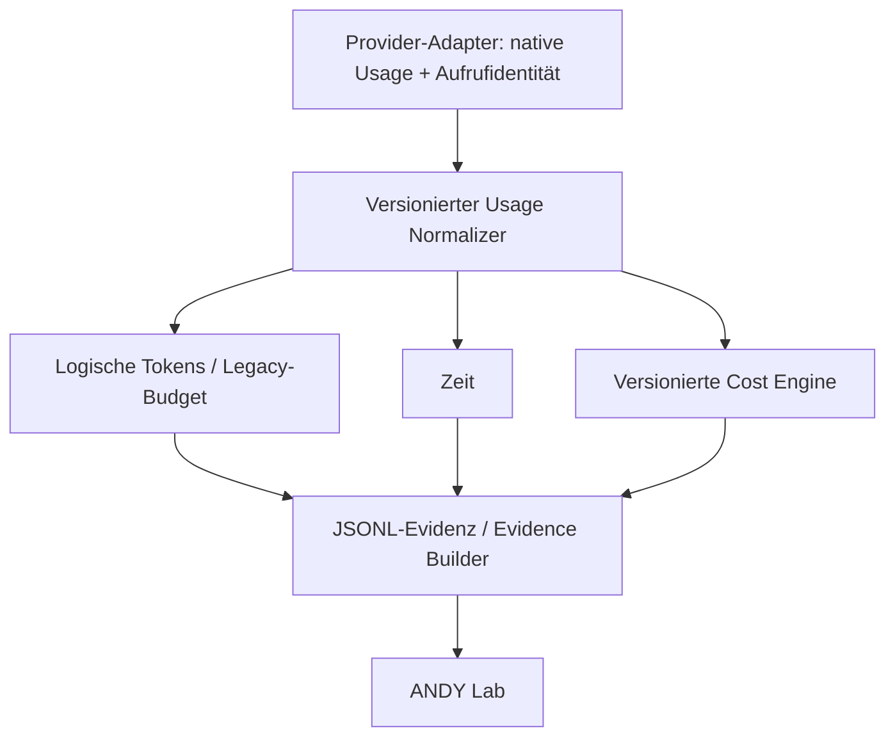

# ANDY CACHE-01 – Usage Audit, Normalizer & Cache Control
**V0.1 · 14.11.2026 · Konsolidierter Entwicklungsauftrag App → Lab**

## 1. Ausgangslage
SYNC-03 (8082 → 8080) wurde von der Projektleitung erfolgreich bestätigt. Laut Patch-Übergabe: Live Center, Reconnect, Checkpoints und bereinigte Toolbar übertragen, Arena/Designer und Schutz produktiver Daten erhalten. 8082-Farbindikator zuvor visuell bestätigt. Lokale Hashes und vollständige Mac-/Browser-Testprotokolle in diesem Memo nicht erneut geprüft. Server-Crash-Recovery bleibt separat.

**Nächster Auftrag: CACHE-01A/P0, read-only und offline auf 8080.** 8082 bleibt Forschungsbetrieb.

Referenzen: [Tarif-Snapshot November 2026](../research/andy-lab/REQUIREMENTS/v0.1/API_COSTS_CACHE_2026-11.md), [App-Lab-Übergabe](ANDY_APP_LAB_SERIES_HANDOFF_2026-11-14.md), [Evidenzvertrag](ANDY_MATCH_EVIDENCE_JSONL_JSON_SQLITE_v1.0.md), [Research Pipeline](ANDY_SERIES_RESEARCH_PIPELINE_SPEC_v0.1.md), [Dezentrale Erkenntnisökonomie](ANDY_MEMO_DECENTRALIZED_RESEARCH_ECONOMY_v0.1.md).

Grundlage: CACHE-01-Briefing aus Web/Lab, DeepSeek (Shadow Architect), Qwen (Chief Logic Architect), Gemini, Claude und anschließendes GPT-Review. Providerinformationen sind Arbeitsannahmen, keine live verifizierten Fähigkeiten der lokalen Adapter. Tests sind spezifiziert, nicht ausgeführt.

## 2. Ziel und Schutz
Drei Ressourcenebenen getrennt erfassen: **Tokens** (bisheriges Wettbewerbsbudget und normalisierter logischer Verbrauch), **Zeit** (API-Latenz, TTFT, getrennt von Runner-Pausen), **Kosten** (geschätzt, cache-neutral und tatsächlich abgerechnet).
Keine rückwirkende Änderung an Original-JSON/JSONL, Sportergebnissen, Leaderboard, TKO, Regeln oder historischen Budgets. Falls historischer Verbrauch unvollständig erfasst wurde: Befund gesondert dokumentieren; neue Budgetsemantik nur explizit versioniert und abgenommen. Cache-Rabatt verändert nicht das sportliche Tokenbudget. 8080 produktive 8082-Daten nur read-only; lokale Testdaten getrennt. Keine bezahlten Calls ohne Freigabe, keine Secrets/privaten Pfade in Exporten, kein automatischer Matchupload.

## 3. Roadmap


| Paket | Inhalt | Abnahme |
|---|---|---|
| SYNC-03 | Gemeinsame App-Basis | Erfolg durch Projektleitung gemeldet |
| CACHE-01A | Adapter-Audit (P0) | Quellen, Mapping-Matrix, offene Befunde |
| CACHE-01B | Usage Normalizer und additive Evidenz | Offline-Fixtures und Regressionen |
| CACHE-01C | Cost Engine | Versionierte Tarife, Abdeckung, Gegenrechnung |
| CACHE-01D | Cache Control und freigegebener Pilot | Nachgewiesene Fähigkeiten, kein Fake-OFF |
| CACHE-02 | Prompt-Architektur | Legacy vs. versioniertes optimiertes Profil |
| CACHE-03 | Lab / Behavior Cards / Forschung | Vergleichbarkeit und Evidenzstatus |
| SYNC-04 | Selektive Übernahme auf 8082 | Backup, Tests, ausdrückliche Freigabe |

## 4. CACHE-01A: Audit zuerst
Aktuelle Branches, Commits, Dateihashes, Adapter, SDK-Versionen, Modellalias → API-ID, Endpoint/Route (native, kompatibel, Gateway, Region/Tier soweit bekannt) prüfen. Alle tatsächlich vorhandenen Provider erfassen: OpenAI Astra/Sol, Gemini Argon/Flash, Anthropic Opus/Sonnet, DeepSeek, Qwen, xAI/Mistral/weitere nach Bestand.
- Request-Building, Thinking/Reasoning/Sampling-Parameter, Systemprompt, Regeln, dynamische Brett-/Verlaufsteile und Präfixstabilität über Züge und Farbwechsel.
- Native Usage vs. SDK-Parsing; verworfene Felder, Default-Nullen, Teilmengen/additive Felder, Abbrüche und Retries.
- Budgetpfad bis Runner, Checkpoint, Resume, JSON/JSONL, Serienfingerprint und Evidence Builder.
- Historische Logs read-only auf Abdeckung prüfen; insbesondere geringe protokollierte Gemini-Ausgabe in Argon–Opus und mögliche Anthropic-Cache-Input-Lücke. Keine Unterzählung allein aus niedriger Ausgabe ableiten.
- Dokumentierte Providerfähigkeiten mit Quelle, Datum, tatsächlicher API-ID/Route, Verifizierungsstatus. P0 ohne neue API-Calls.
Lieferung: Audit-Matrix mit konkreten Codepfaden/Zeilen, Legacy-vs.-Native-Mapping, betroffenen historischen Daten, offenen Feldern und Implementierungsvorschlag. Kein Codewechsel vor Befund.

## 5. Kandidaten für Provider-Mappings (am konkreten Endpoint prüfen)

| Route | Input gesamt | Output / Reasoning | Cache / Control |
|---|---|---|---|
| OpenAI Chat Completions | prompt_tokens | completion_tokens, Reasoning-Details ggf. Teilmenge | prompt_tokens_details.cached_tokens; Writes prüfen |
| OpenAI Responses | input_tokens | output_tokens, Details ggf. Teilmenge | Cache-Details/Writes prüfen; explicit ohne Breakpoints als OFF-Kandidat nur bei nachgewiesener Unterstützung |
| Anthropic Messages | input_tokens + cache_read_input_tokens + cache_creation_input_tokens | output_tokens inklusive Thinking laut Briefing | cache_control, TTL-Aufschlüsselung; toolfreie OFF-Kontrolle prüfen |
| Gemini OpenAI-kompatibel | prompt_tokens | completion_tokens inkl. Thinking laut Briefing, konkret noch offen | Details ggf. unvollständig; kein belegtes per-Request-OFF |
| Gemini native generateContent | usageMetadata.promptTokenCount | candidatesTokenCount + separate thoughtsTokenCount, ggf. weitere Kategorien | cachedContentTokenCount als Input-Teilmenge; explizite Cache-Objekte modellabhängig |
| DeepSeek | prompt_tokens | completion_tokens; Reasoning-Details prüfen | prompt_cache_hit_tokens und prompt_cache_miss_tokens direkt im usage-Block; automatisch |
| Qwen/DashScope/Gateway | routeabhängig | routeabhängig | cached_tokens oder prompt_tokens_details.cached_tokens als Kandidaten |
| Weitere/Legacy | nur belegte Semantik | unbekannt bleibt unbekannt | keine Zuordnung allein nach Feldnamen |

Gemini native Thinking nicht pauschal als Teilmenge von candidatesTokenCount behandeln; Tool- und Gesamtsemantik prüfen. Bestehenden kompatiblen Gemini-Adapter erhalten; native API später optional als eigenes Profil, kein stiller Endpoint-Wechsel. Vertex-Administration separat untersuchen, nicht als per-Akteur-OFF ausgeben. Anthropic TTL-Teilfelder sind Aufschlüsselung der Creation, nicht erneut addieren; adaptive Thinking/Effort und Tool-Ausnahmen prüfen. DeepSeek ältere Hit/Miss-Preis-/Latenzbeispiele nicht als aktuelle allgemeine Tarife verwenden. Qwen Gateway-Schema nicht allein aus Namen ableiten. Quellenlinks im Tarif-Snapshot sowie Prüfansätze https://ai.google.dev/gemini-api/docs/openai, https://api-docs.deepseek.com/guides/kv_cache und https://platform.claude.com/docs/en/build-with-claude/adaptive-thinking (hier nicht erneut geprüft).

## 6. CACHE-01B: Kanonischer Vertrag (Entwurf)
Ein Usage-Event pro tatsächlich versuchtem API-Aufruf (inklusive Retries/Abbruch), nicht nur pro ausgeführtem Zug. Native Usage als Primärbeobachtung bei neuen Calls additiv protokollieren, Normalisierung und Kosten als abgeleitete Evidenz mit Quellen/Version. Historische Originale unverändert. Bestehende Budgetfelder erhalten.

```yaml
usage_event:
  usage_schema_version: "1"
  mapping_version: str
  logical_match_id: str|null
  segment_match_id: str
  decision_index: int
  attempt: int
  call_id: str
  provider_request_id: str|null
  request_hash: str|null
  outcome: str
  provider: str
  provider_endpoint: str|null
  endpoint_mode: str|null
  provider_model_id: str|null
  service_tier: str|null
  account_group_id: str|null
  prompt_profile_version: str|null
  prompt_prefix_hash: str|null
  requested_cache_mode: AUTO|ON|OFF|UNKNOWN
  effective_cache_mode: str|null
  cache_control_supported: bool|null
  usage_raw: object|null
  canonical:
    input_tokens_total: int|null
    input_tokens_uncached: int|null
    cache_read_tokens: int|null
    cache_write_tokens: int|null
    cache_write_ttl_components: object|null
    output_tokens_total: int|null
    reasoning_tokens: int|null
    visible_output_tokens: int|null
    logical_tokens_total: int|null
  timing:
    request_ts_utc: str|null
    api_latency_ms: int|null
    time_to_first_token_ms: int|null
  cost:
    estimated_cost: decimal|null
    cache_neutral_cost: decimal|null
    actual_billed_cost: decimal|null
    currency: str|null
    price_table_version: str|null
    formula_version: str|null
  evidence:
    usage_evidence: str
    consistency: str
    missing_fields: list
    unknown_semantics: list
    source_ref: object|null
```
Feldnamen sind Entwurf, an bestehende Verträge anschließen. Zusätzliche Tool-/Storage-Kategorien separat berücksichtigen. Decimal verlustfrei serialisieren. Keine rohen API-Keys oder Key-Hashes; bei Bedarf zufällig vergebene pseudonyme Account-Gruppe. Nur sichere Usage-Metadaten speichern; problematische Daten blockieren bzw. redigierte Derivate kennzeichnen.

Null ≠ 0. Null bei fehlender oder unbekannter Semantik; 0 nur beobachtet oder aus verifizierter Semantik sicher ableitbar, mit Herkunft. Konfiguration allein erzeugt keine beobachtete Null. Unbekannte Gesamtsemantik: berichtete Rohzähler erhalten, kanonisches Total offen. Teilaggregate mit Abdeckung/Lücken/Konflikten, keine vollständigen Summen vortäuschen. Konflikt blockiert betroffene normalisierte Kennzahl, nicht bestehende Sportwertung.

Stabile call_id pro Versuch vor Versand; Provider-ID falls vorhanden. Deduplikation anhand belegter gemeinsamer Aufrufidentität/Quellprovenienz, nie allein Request-Hash (identische Prompts können mehrfach abgerechnet werden). Resume-Ketten über bestehenden logischen Match-Resolver; ungeklärte historische Überlappung sichtbar.

## 7. Offline-Testvertrag: Qwen UN-01–10, korrigierte Erwartungen
Alle Fixtures synthetisch, noch nicht ausgeführt.
| ID | Given / When | Then |
|---|---|---|
| UN-01 | 1200/340 ohne Details; nur total_tokens=900 | Rohwerte erhalten, fehlende Details null, keine erfundene Zerlegung |
| UN-02 | Output 500, Reasoning 380, subset/additive/unknown | 500 bei belegter subset-, 880 bei additiver Semantik; bei unbekannt Gesamtoutput null, Rohwerte separat |
| UN-03 | Anthropic excl=200/write=1500/read=8000; OpenAI total=9700/read=8000, Writes unbekannt | beide Input 9700; OpenAI-Rest 1700 nicht als sicher uncached klassifizieren, solange Writes offen |
| UN-04 | capability=false/null/true | keine beobachtete Null aus Konfiguration; gemeldete Reads erhalten |
| UN-05 | Transportabbruch mit 5000/12 | 5012 berichtete Tokens erhalten, Vollständigkeit/Abrechnung offen, kein Legalzug |
| UN-06 | drei Versuche 300/40, 300/38, 300/45 | 900 Input, 123 Output bei belegter Semantik; drei Calls, eine Aktion |
| UN-07 | Segmente 1–80/81–140 plus erneuter Export 75–80 | nur belegte identische call_ids einmal zählen; Import idempotent |
| UN-08 | Legacy tokens_in=700/tokens_out=90, Semantik unbekannt | Legacy-Zähler erhalten, normalisierte Totals offen |
| UN-09 | Reads > Input, Reasoning > inklusiver Output, negative Zähler | CONFLICT mit Quellreferenz/Regelversion, keine Auto-Korrektur; Teilaggregate offen |
| UN-10 | Request 10.11., Tarifwechsel 01.12. | historischen Preis pinnen; aktuelle Vergleichsrechnung getrennt; Cache-Write kann Mehrkosten verursachen |

Zusätzliche Fixtures:
- UN-11 Gemini nativ: candidates=120, thoughts=380 → Output gesamt 500 bei belegter additiver Semantik, nicht 120. Cached Input nicht erneut addieren.
- UN-12 Claude: 412 uncached +3600 write (5m) +0 read, Output 1950 inkl. 1830 Thinking → Input 4012, logisch 5962. Zweiter Call 640 uncached +3600 read, Output 1700 → Input 4240, logisch 5940. TTL-Teilfelder nicht doppelt zählen. Illustrative Tarifwerte 4/20/5/0,20 USD pro MTok → 0,058648 und 0,03728 USD, cache-neutral zweiter Call 0,05096 USD. Keine Rechnungsdaten.
- UN-13 DeepSeek: prompt=15420, hit=12800, miss=2620, completion=892 → Input 15420, Ratio 12800/15420. Bei belegter Partition abweichende Summe als Konflikt.
- UN-14 Qwen/Gateway: gleiche Feldnamen, unterschiedliche Semantik; ohne verifiziertes Mapping Rohwerte sichern, Totals offen.
- UN-15 Identische Prompts in zwei echten Calls vs. Reimport desselben Calls; nur letzterer deduplizieren.
- UN-16 fehlende Usage, fehlendes TTFT, fehlender Preis, Secrets → Lücken bzw. Exportblockade.
- UN-17 Legacy Replay, Budget, Resume, Serien, Leaderboard regressionsfrei; keine Änderungen an produktiven 8082-Daten.

Konsistenzregeln versionieren: nichtnegative Zähler, disjunkte Reads+Writes ≤ Input soweit belegt, Reasoning ≤ inklusiver Output, Anthropic Input-/TTL-Identitäten, DeepSeek Hit/Miss-Partition, Preis-Recompute mit dokumentierter Rundung. Kein globales Mapping allein nach Feldnamen.

## 8. CACHE-01C: Kosten
Disjunkte abrechenbare Kategorien × jeweiliger Tarif / 1e6 plus Storage-/Toolkosten. Tarife versionieren nach exakter Modell-ID, Endpoint/Route, Nutzungsdatum und ggf. Uhrzeit, Kontextklasse/Tier/TTL/Währung; Quellen und Gültigkeit dokumentieren. Keine pauschalen Rabattfaktoren. Kosten je Call/Akteur/logischem Match/Serie, Abdeckung sichtbar. USD Tarifwährung; EUR mit dokumentiertem Umrechnungskurs oder Rechnung.

estimated_cost statt billed_cost für Tarifberechnung; actual_billed_cost nur belegt und auf passendem Aggregationsniveau. cache_neutral_cost = dieselben beobachteten Tokens zum regulären Input-/Output-Tarif ohne Cache-spezifische Writes/Storage: kontrafaktischer Tarifvergleich, keine Simulation anderer Spielverläufe. Writes können zunächst teurer sein. cache_hit_ratio = read/total nur bei belegtem total > 0 und bekannten Reads; Serienratio aus Summen derselben abgedeckten Teilmenge. Kosten pro ausgeführter Aktion inklusive Fehlversuchen; keine Division durch 0.

## 9. CACHE-01D: Bedienung und Pilot
Pro Akteur AUTO/ON/OFF; Parameter wandert mit Modell beim Farbwechsel. AUTO erhält bestehendes Verhalten. ON nur bei belegter bewusster Steuerung; bei rein automatischem Cache genügt AUTO. OFF nur bei konkret dokumentierter und am Endpoint überprüfter Deaktivierung, auch serverseitig validieren. Historisch UNKNOWN. Requested mode, effektive Einstellung/Capability und beobachtete Reads/Writes getrennt. Miss beweist nicht OFF, ON garantiert keinen Hit. Cache-/Endpoint-/Prompt-Version in Serienfingerprint, Rematch und Export.

Kostenpflichtiger Pilot erst nach ausdrücklicher Freigabe: kurze identische stabile Präfixe mit kontrollierten Suffixen, belegte Mindestlänge, Cold/Warm, TTL/Reihenfolge, Modellversion, Isolation und Rate-Limits dokumentieren; kein künstliches Padding. Native Usage, vollständige logische Tokens, Reads/Writes, API-Latenz, TTFT nur tatsächlich gemessen. Anthropic toolfreie OFF-Kontrolle, Breakpoint/Auto-Caching, Effort/TTL separat. Gemini native vs. Legacy separat. Erst danach kleine Farbtausch-Matchserien mit Kostenlimit.

## 10. CACHE-02/03: Prompt- und Forschungsexperimente
DeepSeek-Vorschlag: stabiles Regelwerk/Ausgabeformat möglichst vor Rolle/Farbe und dynamischer Stellung; Verlauf nur soweit tatsächlich monoton, Entscheidungsfrage zuletzt. Bestand zuerst prüfen. Jede Prompt-Umordnung ist eigenes versioniertes Profil, weil Verhaltensänderungen möglich sind. Zufalls-ID als Cache-Buster ändert Input und ist kein reines OFF.

Caching ist Infrastruktur-/Runner-Variable im Nested Competitive Network, kein Nachweis von Intelligenz oder kognitiver Vertrautheit. Reads beobachtet, Ratio berechnet, Warmup-Signatur interpretiert. Qwen TEST-CACHE-01 offline: vergleichbare Calls, erste belegte Reads vs. Latenzkurve, Schwellen/Fenster vorab, Prompt-/Output-Länge, Netzlast, Pausen und Retries kontrollieren. Zeit zwischen Entscheidungen ≠ API-Latenz. Korrelation beweist keine Kausalität.

Späteres idealtypisches 2×2-Design (DeepSeek, GPT-korrigiert): verifiziertes ON/OFF × homogene/heterogene Modellpaarung; ohne echtes OFF keine OFF-Gruppe behaupten. Replikate, Farbtausch, randomisierte/blockierte Reihenfolge, kontrollierte Modell-/Endpoint-Bedingungen, unterstützte Sampling-Parameter. Strategie separat operationalisieren (vorab definierte Antizipation/Überraschung, geprüfter legaler Zustandsraum, valide Engine-Referenz), Kosten/Zeit/Execution getrennt. Ähnlicher Homogenitäts-Effekt bei ON und OFF wäre mit cache-unabhängigem Mirroring vereinbar; abweichender Effekt mögliche Interaktion, kein Nachweis. Nullbefund allein falsifiziert nicht jede Variante; Effektgrenze/Teststärke vorher festlegen.

Cache-Rabatt bei unverändertem logischen Budget gibt keinen zusätzlichen sportlichen Handlungsspielraum. Sweet Spot?, Competitive Mirroring und Behavior Cards bedingungsabhängig interpretieren. Cache als E2-Kontext/erklärende Variable, kein AQP-Qualifikationsschwellwert, keine Änderung von E3 oder Hypothesen-IDs.

## 11. Abnahme und Übergabe
Selektive Pakete mit Vorprüfung, Backup, Rollback, Offline-Fixtures und bestehenden Regressionen auf 8080; neue JSONL-Evidenz additiv, Evidence Builder mit Quellen/Version/Abdeckung/Konflikten. SQLite-Projektion später idempotent und lokal getrennt, keine produktive Migration ohne Auftrag. Keine parallelen widersprüchlichen UI-Berechnungen. Browser-Abnahme für Control, Farbwechsel, Serienfingerprint. Erst danach SYNC-04 nach ausdrücklicher Freigabe.

**Status:** SYNC-03 erfolgreich gemeldet. CACHE-01A als Nächstes. Memo ist Spezifikation, kein Testnachweis; keine lokale Adapterprüfung, Codeänderung, Datenmigration, Preisverifikation oder API-Aufrufe durch dieses Memo. Anbieterbriefings allein sind keine Primärnachweise.
