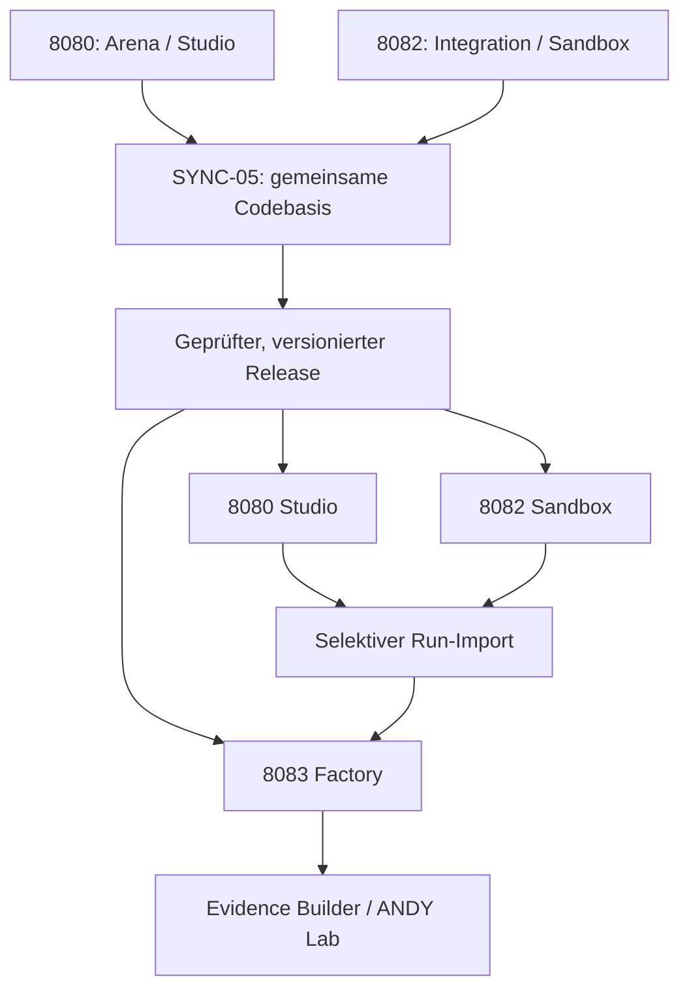

# ANDY Factory – Drei-Instanzen-Architektur
**V0.1 · 15.11.2026 · Architekturentscheidung der Projektleitung / Entwicklungsauftrag an Thread 1**
 
**Status:** Konzept freigegeben; Implementierung, Konsolidierung und Migration noch ausstehend. Dieses Memo konkretisiert den operativen App- und Forschungsbetrieb; der Masterplan bleibt übergeordnet.

## 1. Ziel und Anlass

ANDY braucht einen kontinuierlichen, reproduzierbaren Forschungsbetrieb, der nicht durch Arena-Entwicklung, API-Experimente oder häufige Neustarts unterbrochen wird. Die Projektleitung schlägt deshalb drei eigenständige Game-Instanzen vor:

**8080 gestaltet. 8082 experimentiert. 8083 produziert. ANDY Lab forscht.**

Der aktuelle DeepSeek-Pilot (ORE-01) zeigt den Bedarf an kontrollierten Vergleichen von Reasoning, Outputlimit, Caching und Domänen. Langfristig soll eine freigegebene Warteschlange viele vergleichbare Partien erzeugen, während die übrigen Instanzen unabhängig weiterentwickelt werden. Kein neuer, paralleler Serienbestand.

## 2. Zielarchitektur

| Instanz | Arbeitsname | Verantwortung | Betriebsprinzip |
|---|---|---|---|
| 8080 | STUDIO | Arena, Designer, Animation, Interaktion, ANDY Academy | UI-Entwicklung, lokale Testdaten |
| 8082 | SANDBOX | API/Runner, Reasoning, Cache, Domain Isolation, technische Regressionen und Live-Piloten | kontrollierte Experimente, eigene Testdaten |
| 8083 | FACTORY | Freigegebene Forschungsruns, Match Queue, Rematches, Autoplay, Evidenzproduktion | eingefrorener Release, keine Entwicklungsänderungen während des Betriebs |
| ANDY Lab | Analyse | Serienvergleiche, Model Behavior Cards, Forschungsberichte | lesender Zugriff bzw. geprüfte Exporte |

Gemeinsamer Programmcode zum Zeitpunkt einer Release-Freigabe, getrennte Konfiguration je Instanz (Port, Rolle, Schreibrechte, Archivpfade). Jede Instanz hat eigene Arbeitsverzeichnisse, lokale Runs, DBs, Checkpoints, Locks und Prozesse. Keine gegenseitigen produktiven Schreibzugriffe. API-Zugangsdaten separat und lokal verwalten, nie im Repository oder Export. Eine spätere gemeinsame lesende Archivansicht darf keine Testpartien als Forschungsruns ausgeben.

Die Rollenbezeichnungen STUDIO, SANDBOX und FACTORY sind Arbeitsnamen. Ob 8083 zunächst auf dem Mac oder auf einem separaten Host läuft, bleibt zu entscheiden. Ein lokaler Dauerbetrieb hängt von Stromversorgung, Ruhezustand, Netzwerk und Prozessüberwachung ab.

## 3. SYNC-05 – vollständige funktionale Konsolidierung (zuerst)

Ausgangslage laut Projektleitung am 15.11.2026:
- SYNC-04 (8080 → 8082) technisch erfolgreich: 201 Tests bestanden, 30/30 Zieldateien geprüft; 8080 unverändert, keine Runs/DBs übernommen. Browser-Abnahme laut Installer noch offen.
- SERIES-CACHE-01A auf 8080 technisch bestätigt und Bestandteil von SYNC-04. Lesende Cache-Profilintegration; keine fingierten ON/OFF-Modi.
- OUTPUT-LIMIT-01 (8080, 8192 für den begrenzten DeepSeek-Pilot) technisch grün gemeldet; allgemeine Freigabe und echte API-Verifikation nicht aus dieser Meldung ableiten.

Vollständiger beidseitiger Funktionsabgleich statt blindem Kopieren in beide Richtungen. Insbesondere Arena/Designer aus 8080 und Serien-/Archiv-/Runner-Funktionalität aus 8082 zusammenführen. Aktuelle lokale Quellen, Branches, Commits, uncommittete Änderungen, Startkonfigurationen und Abhängigkeiten zunächst read-only erheben. Gemeinsamen Codebestand in isolierter Integrationskopie konsolidieren. Bestehende UI-Varianten und instanzbezogene Schutzmechanismen gezielt erhalten bzw. anhand der Instanzkonfiguration steuern.

Empfohlener Zielprozess:
1. Beide Arbeitsstände sichern (Code, Konfigurationen, lokale Änderungen; Datenarchiv gesondert).
2. Datei-/Funktionsinventar, Konflikte und Unterschiede dokumentieren; Quellcode und instanzspezifische Daten unterscheiden.
3. Selektiv mergen und gemeinsame Tests ausführen, ohne bezahlte API-Aufrufe.
4. Browser-Abnahme beider Instanzen: Arena, Designer, Live/Reconnect, Replay, Serien, Rematch, Cache-Evidenz, Export und Schreibschutz.
5. Freigegebenen gemeinsamen Git-Release mit Commit-ID, Prüfsummen und Rollback-Referenz erstellen; 8080/8082 bei sicherer Spielpause aktualisieren.
6. Aus genau diesem freigegebenen Stand 8083 bereitstellen, ohne dessen eigene Daten/Geheimnisse mit Code-Updates zu überschreiben.

Kein automatischer Git-Pull, Hot-Reload oder Neustart für Factory während eines laufenden Matches. Keine unkontrollierte Änderung von Regeln, Budgets, Ergebnissen oder historischen Profilen. Code-Sync und Datenmigration bleiben unabhängige Vorgänge.

## 4. FACTORY-01 – dritte unabhängige Instanz

8083 aus dem konsolidierten Release aufsetzen. Separate Runtime/Prozesskonfiguration, eigenes Run-Archiv, eigener DB-Stand, eigene Live-Recovery-Dateien. Bestehende Live-Recovery- und Runner-Logik wiederverwenden. Ein einfaches, offline geprüftes manuelles Match-Setup und UI-Abnahme vor Freigabe des Autoplay. Keine automatischen kostenpflichtigen Starts bei Installation oder Serverstart.

Release-Wechsel nur bei leerer/pausierter Queue und ohne laufende Partie; Rollback muss Code und dazu kompatible Konfigurationen wiederherstellen können. Persistente Queue und Originale nicht durch Code-Rollback verlieren.

## 5. FACTORY-02/03 – persistente Match Queue und Autoplay

Die vorhandene Serial-Engine, Profile, Rematch-Logik und den zentralen Matchstart erweitern. Keine zweite Serien-Engine und keine zusätzliche wissenschaftliche Auswertungskomponente in der App. Die Queue ist Ausführungsebene, nicht Forschungsdatenbank.

### Bedienung
- Freigegebene Match- oder Rematch-Konfigurationen hinzufügen, Reihenfolge ändern, wartende Aufträge entfernen.
- Aktuelles Match mit Fortschritt, Modellrollen, Profil, Budget und Status anzeigen.
- Autoplay ausdrücklich aktivieren; nach aktueller Partie pausieren; Queue fortsetzen.
- Abgeschlossene, fehlgeschlagene, blockierte und wartende Aufträge unterscheidbar anzeigen.
- Konfigurationen beim Einreihen einfrieren bzw. vor dem Start auf Änderungen prüfen. Rematch-Farbtausch übernimmt die akteursbezogenen Einstellungen.
- Beispiel: Referenzmatch → Farbtausch → weiteres Profil → nächste Paarung. Keine implizite Wiederholung oder automatische Erzeugung neuer kostenpflichtiger Aufträge.

### Ausführung und Schutz (vorgeschlagener Vertrag)
Ein Worker pro Factory, eine aktive Partie. Stabile Job-ID und zugeordnete Match-ID; Startreservierung atomar und idempotent. Persistente Zustände z.B. queued / running / completed / failed / blocked / cancelled. Abschluss erst nach gespeichertem Originalbericht und JSONL sowie geprüftem Archivstatus; danach nächster freigegebener Auftrag. Keine Doppelstarts bei Reload, Prozesswiederanlauf oder mehreren Browsern.

Autoplay nur innerhalb eines ausdrücklich freigegebenen Auftragsumfangs mit Match-/Call-/Tokenlimits und separater Kostenfreigabe. Logisches Tokenbudget ist keine Kostenobergrenze. Bei unbekannten/unzureichenden Tarifen, unklarer Abrechnung, technischen Fehlern, Rate Limits oder Archivkonflikten sicher blockieren bzw. gemäß vorher festgelegter begrenzter Fehlerpolitik pausieren. Kostenschätzung, bestätigte Abrechnung und unbekannte Beträge getrennt. Keine unbegrenzte Retry-Schleife. Keine bezahlten Calls bei Offline-Tests.

## 6. FACTORY-04 – zuverlässiger Dauerbetrieb

Browserunabhängiger Runner, Reconnect und Checkpointing auf bestehender Architektur. Prozessausfall ist nicht gleich Browserabbruch: nach Crash vorhandene Locks, Job-/Match-ID und Originaldaten prüfen. Keine automatische Wiederholung einer unklar abgebrochenen API-Anfrage; keine fiktiven Usage-Werte. Kontrollierter Wiederanlauf erst nach belegter Zustandskonsistenz, ansonsten blockierter Auftrag mit Diagnose.

Überwachung: aktives Match, Queue-Zustand, letzte Fortschrittszeit, Fehler, Kosten-/Budgetstatus, Plattenplatz, Backups. Wartungs- und Wiederanlaufverfahren offline testen. Ziel ist verlässlicher Dauerbetrieb, nicht ein bereits zugesicherter 24/7-Service.

## 7. ARCHIVE-IMPORT-01 – Forschungsdaten später kontrolliert migrieren

Die bisherigen Partien müssen nicht vor dem Code-Sync verschoben werden. 8083 soll nach Freigabe der Migration als zentrales Forschungsarchiv dienen; 8080/8082 können es lesend nutzen. Historische Originale bleiben dort erhalten, wo sie entstanden sind, bis die neue Kopie nachgewiesen und die Aufbewahrung geklärt ist.

| Objekt | Behandlung |
|---|---|
| Original-JSONL + Abschluss-JSON | byteidentische Kopie mit Hashprüfung |
| Match-ID / logische Match-ID | erhalten; Resume-Segmente getrennt |
| Serienzugehörigkeit / Sidecars | einschließlich Variantenwurzeln und historischer Bestätigungen mit Provenienz |
| SQLite V1 / V2 Shadow | vorhandenen Archivimport prüfen und wiederverwenden; konsistente Backups, idempotente Projektion und Abgleich |
| Live-Checkpoints / Locks | nicht pauschal übertragen; laufende Partien ausschließen |
| Test-/Zufallspartien | getrennt halten, keine ungerechtfertigte sportliche Wertung |

Zunächst Inventar aus beiden Instanzen: identisch, fehlend, Konflikt, unvollständig, aktuell laufend, Forschungs-/Teststatus. Vor Freigabe Herkunft und Vollständigkeit überprüfen; fehlender historischer Protokollrahmen ist kein Beweis für irrelevante Daten. Bekannte 19 Übernahmekandidaten aus der 8080-Vorprüfung sind eine vorläufige Auswahl, keine pauschale Importfreigabe. Darunter die drei DeepSeek-Referenzpartien mit unterschiedlichen Reasoning-Profilen (Default/Default, Default/Low, Low/Low); nicht zu einer regulären Rematch-Serie vermischen.

Import erst in isolierter Kopie und dann bewusst auf freigegebenes Archiv bei sicherer Spielpause. Keine Datenüberschreibung bei abweichendem Hash derselben ID; Konflikte manuell prüfen. Importbericht mit Quellinstanz, Hashes, Zeitpunkt, Schema-/Importversion und DB-Abgleich. Archivierung ist nicht automatisch Leaderboard-Berechtigung. Historische Daten, TKO-Entscheidungen und ursprüngliche Budgets nicht rückwirkend umdeuten. Keine Rohprotokolle oder privaten Pfade in öffentliches GitHub committen.

## 8. Forschung und Entwicklungsreihenfolge

| Paket | Aufgabe | Gate |
|---|---|---|
| SYNC-05 | Vollständige Konsolidierung 8080/8082 | gemeinsamer Release, Offline- und Browser-Abnahme |
| FACTORY-01 | Unabhängige 8083-Instanz | getrennte Runtime/Daten, manueller Betrieb geprüft |
| ARCHIVE-IMPORT-01 | Kontrollierter Forschungsrun-Import | Dry-run, Dubletten-/Konflikttests, explizite Auswahl |
| FACTORY-02 | Persistente Queue auf vorhandener Serial-Engine | Offline-Lifecycle, Rematch/Farbtausch, Neustart- und Doppelstarttests |
| FACTORY-03 | Autoplay, Ressourcenlimits, Fehlerpolitik | explizite Freigabe, begrenzte Pilotqueue |
| FACTORY-04 | Wiederanlauf und Dauerbetrieb | Crash-/Reconnect-/Backup-Abnahme |
| DOMAIN-01/02 | ANDY-ABC: Chess-only, Go-only, Hybrid | zuerst kontrollierter Offline-Domänentest; später eigenständige Profile/Regelversionen |
| REASONING-01 | Provider-/phasenabhängige Reasoning-Profile | unterstützte Parameter, pro Versuch protokolliert |
| CORRECTION-01 | Fehlerspezifische Korrektur | keine spontanen Profilwechsel, keine unendlichen Retries |
| CACHE-02 / OUTPUT-LIMIT-02 | Prompt- und optionale weitere Outputlimit-Experimente | getrennte Profile, Endpoint-Nachweis |

Gestaltungs- und Technologieentwicklung kann nach Einrichtung der Factory unabhängig fortlaufen. Reihenfolge der späteren Forschungsfeatures nach Evidenz und Aufwand verfeinern, nicht ungeprüft in 8083 ausrollen. ORE-01 vergleicht Ausführungszuverlässigkeit, Ressourcen pro Versuch und pro erfolgreicher Aktion sowie strategische Qualität getrennt. ANDY-ABC muss domänenspezifische Regeln, Prompts, Replay und Wertung berücksichtigen; ein Schalter allein genügt nicht. Kein Nachweis einer generellen Go-Schwäche oder eines gefundenen Sweet Spots aus den bisherigen wenigen Testmatches.

## 9. Aufträge an die beteiligten Threads

- **Thread 1 / App:** jetzt SYNC-05 als lesenden Audit vorbereiten, dann gemeinsame Codebasis und Factory. Keine Änderungen während laufender Matches; lokale Quellen vor Patch prüfen.
- **Web / Arena:** Studio bleibt Entwicklungs- und Darstellungsumgebung. Freigegebene Matchdaten können später für Replay und Fight Night verwendet werden. Keine direkte Steuerung der Factory durch öffentliche Website.
- **Lab:** Serienprofile, Provenienz, Domänen, Reasoning, Cache und Usage als Forschungsbedingungen behandeln. Auswertung im Lab statt in der Factory. Evidence Builder als bestehende Schnittstelle.
- **Challenger (DeepSeek, Qwen etc.):** Architektur, Wiederanlauf, Versuchsdesign und Abnahmekriterien kritisch prüfen; Hypothesen nicht mit Messnachweisen gleichsetzen.

## Referenzen
- [Thread-Einstieg](ANDY_THREAD_START_HIER.md)
- [Masterplan](ANDY_GESAMTKONZEPT_MASTERPLAN_v1.0.md)
- [App-Lab-Serienübergabe](ANDY_APP_LAB_SERIES_HANDOFF_2026-11-14.md)
- [CACHE-01 Memo](ANDY_CACHE_01_IMPLEMENTATION_MEMO_v0.1.md)
- [Match-Evidenzvertrag](ANDY_MATCH_EVIDENCE_JSONL_JSON_SQLITE_v1.0.md)
- [Research Pipeline](ANDY_SERIES_RESEARCH_PIPELINE_SPEC_v0.1.md)

**Abgrenzung:** Dieses freundlich freigegebene Architekturkonzept ist kein Nachweis eines bereits laufenden 8083-Servers. Queue, Autoplay, Import und Release-Konsolidierung sind noch Entwicklungsaufgaben. Keine Programmdateien, Datenbanken, Runs oder API-Anfragen durch diesen Doku-Commit verändert.

## 10. Ergänzung 15.11.2026 – portable Standalone Factory und SYNC-05A

**Ergänzende Anforderung der Projektleitung:** Factory als eigenständig installierbare Forschungsinstanz auf demselben oder einem anderen Rechner; später mehrere Factories aus demselben freigegebenen Release. Kein eigener Engine-Fork. Studio und Sandbox werden zum Betrieb nicht benötigt.

Pareto-Umsetzung: zunächst portable Python-Installation mit dokumentierten, gepinnten Abhängigkeiten, reproduzierbarem Release-Manifest, konfigurierbarem Server-Port/Bind-Adresse, stabiler zufälliger Instanz-ID, eigenem Runtime-/Runs-/DB-/Queue-Verzeichnis und lokal bereitgestellten Provider-Secrets. Die Factory enthält Engine, Runner, API-Adapter, Serien, Replay, Queue, Autoplay und Evidenzexport; Designer und vollständiges Lab sind nicht notwendig. Freigegebenes Design als statische Ressource erhalten; Designer-Schreib-/Git-Aktionen in Factory deaktivieren. Docker erst später, kein neuer Cloud-Dienst im ersten Schritt. Browserzugriff zunächst lokal; Fernzugriff erst nach gesondertem Authentifizierungs-/TLS-/Netzwerkkonzept, kein öffentlich ungeschützter Matchstart.

Pro Instanz Release-ID, Instanz-ID, Match-/Job-ID und experimentelles Profil in der Evidenz mitführen; bestehende IDs und historische Originale bewahren. Standardisierte Serienexporte und idempotenter, hashgeprüfter Import in ein gemeinsames Forschungsarchiv. Keine gemeinsame schreibbare SQLite-Datei über Rechnergrenzen. Für parallel betriebene Factories getrennt freigegebene Kostenkontingente aus einem Gesamtbudget; echte übergreifende Live-Kostensteuerung ist ein späterer Schritt. Keine automatischen Starts bei Installation. Beitragsmodell Dritter erst mit Datenschutz-/Lizenz-/Qualitätsprüfung.

### Tatsächlich geprüfter SYNC-05A-Zwischenstand
Quell-Audit-ZIP am 15.11.2026 eingelesen: ZIP-CRC fehlerfrei, 431/431 tatsächlich enthaltene Quell- und Assetdateien gemäß Manifest in Größe und SHA-256 geprüft. 236 Dateien aus 8080, 195 aus 8082; 241 unterschiedliche Pfade insgesamt: 173 inhaltlich identisch, 17 abweichend, 46 nur 8080 und 5 nur 8082. Zusätzlich eine in beiden Ständen hashidentische, vom Geheimnisfilter ausgelassene Testdatei (aus früherem Patcharchiv byteidentisch rekonstruierbar). Der statische AST-Syntaxcheck aller enthaltenen Python-Module ergab keine Syntaxfehler. Das ist kein vollständiger Regressionstest.

Konkrete Merge-Befunde:
- ANDY_app.py: Port hart codiert; Startskript ebenfalls an einen Port gebunden.
- 8080: expliziter Leseschutz, aber Archivsuche abhängig von lokalen Ordnernamen; Leaderboard mit festem lokalem DB-Pfad. Serien-/Replay-Navigation teilweise auf Loopback-Port 8082 fixiert.
- 8082: produktive Live-Resume-, Matcharchiv- und Serienstart-Funktionen, die 8080 bewusst nicht zulässt. Beide Verhaltensweisen über explizite Instanz-/Archivberechtigungen erhalten, nicht pauschal gegenseitig überschreiben.
- 8080: Arena-Broadcast-Erweiterungen und OUTPUT-LIMIT-01 erhalten. 8082: Designer-Origin-Prüfung bereits portbezogen; HTML-Preview, Genehmigungsbranch und Git-Aktionen von Rolle und Deployment entkoppeln. Keine Sicherheitsprüfungen entfernen.
- Audit-Filter hat das Python-Paket andy/infrastructure/archives sowie benötigte Designer-JSON-Ressourcen nicht exportiert. Die fehlenden Archive-Module werden tatsächlich importiert; vollständiger Merge aus diesem ZIP allein nicht freigabefähig. Audit V2 erweitert den Export nur für das benannte Codepaket und genau bezeichnete Designer-JSONs; weiterhin keine Runs/DBs/Secrets. Ausgewählte installierte Abhängigkeiten und Speicher-Linkflags ohne Zielpfade als Diagnostik. Die konkrete lokale V2-Ausgabe steht noch aus.

### Abnahme SYNC-05 / FACTORY-01 (zusätzlich)
1. Identischer freigegebener Codebestand, getrennte beschreibbare Datenspeicher; expliziter lesender Fremdarchivzugriff, keine implizite Zuordnung anhand Port/Ordnername.
2. Offline-Lauf in frischem, beliebig benanntem Verzeichnis ohne Studio/Sandbox, mit separaten Testdaten und anderem Port; kein Provider-Call.
3. Native Laufzeit-/Abhängigkeitsprüfung am Zielrechner, dokumentierte Installations- und Startschritte.
4. Designer-Rechte nur in freigegebenen Entwicklungsrollen; Factory ohne Git-Schreibrechte betreibbar.
5. Export aus zwei isolierten Instanzen und idempotenter Import in Testarchiv ohne Doppelzählung.
6. Erst nach Offline- und lokaler Browser-Abnahme: begrenztes, ausdrücklich freigegebenes Live-Match und Autoplay-Pilot.

**Status:** Audit-Zwischenstand, noch kein gemeinsamer Release. Kein Code, keine DBs und keine Partien durch diese Dokumentation geändert. Kein Docker- oder Multi-Host-Betrieb bereits implementiert.
