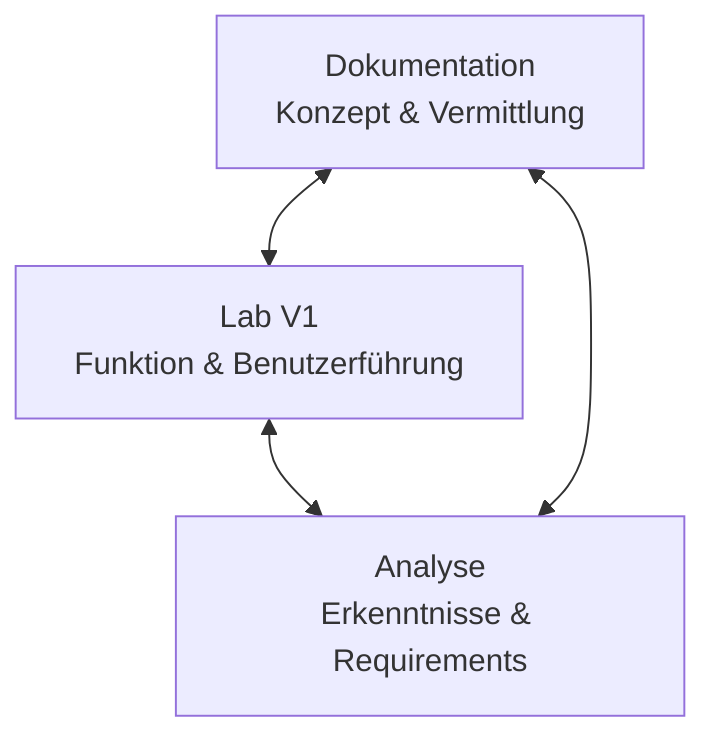

# ANDY – Actor. Network. Dynamics.
## Making of: Homogenität in der Vielfalt – Living Lab als Entwicklungsprozess

20.11.2026 · Gesprächs- und Prozessprotokoll v0.1 · Von der Projektleitung bestätigte Arbeitsrichtung; Synthese und technische Abnahme offen.

## 1. Anlass und Bedeutung

Parallel zur Entwicklung der ANDY Lab V1 wird die Dokumentation weiterentwickelt. Die Projektleitung bezeichnet diese Phase als besonders spannend, weil sie im Kern das „Herz“ von ANDY trifft. ANDY untersucht Netzwerkdynamik nicht nur im Spiel, sondern erlebt sie auch in seiner eigenen Mensch-KI-Kollaboration. Das Making of soll diesen Prozess einschließlich seiner Reibungen, Irrtümer, Korrekturen und offenen Fragen nachvollziehbar machen.

Leitprinzipien: **Actor. Network. Dynamics. – Erleben. Erforschen. Erahnen. – Homogenität in der Vielfalt – Kontinuität im qualitativen und quantitativen Wandel.**

## 2. Beobachteter Ablauf

- Bestehende Lab-Ansichten auf 8082 dienen als Ausgangspunkt: Home/Forschungsrundgang, Modellvergleich, Zuverlässigkeit, Experimente, Spielverlauf, Methodik, historische Daten und KI-Forschungsassistent. Screens vom 20.11.2026 zeigen den Nutzerstand; keine technische Abnahme.
- Drei Perspektiven (DeepSeek, Qwen, ChatGPT Analysis) entwickeln Vorschläge zum Lab und zur Dokumentation. Ihre Ergebnisse sind laut Projektleitung spannend, aber teilweise unterschiedlich.
- Die vorherige Docs-Review konsolidierte die Schwerpunkte emotionaler und niedrigschwelliger Einstieg (DeepSeek), Informationsarchitektur und Flywheel (Qwen), individueller Erkenntnisnutzen (ChatGPT Analysis). Das sind zusammengefasste Rückmeldungen, keine vollständige Wiedergabe sämtlicher Einzelreviews.
- Die Projektleitung beauftragt nun einen vierten, neutral angelegten ChatGPT-Thread mit einem ersten integrativen Aufschlag zu Lab V1 und Dokumentation. „Neutral“ bezeichnet den Arbeitsauftrag, nicht nachgewiesene Unvoreingenommenheit. Der Integrator soll unterschiedliche Perspektiven verbinden, nicht über ihre Richtigkeit abstimmen.
- Der Analysis-Thread liefert weiterhin reale Referenzfälle, Erkenntnisfragen, Vorschläge für Visualisierungen und Requirements sowie Prüfung des tatsächlichen Erkenntnisnutzens. Der vierte Thread übernimmt zunächst die übergreifende Synthese und Benutzerführung.
- Die Projektleitung bestätigt diesen Prozess. Der erste integrative Entwurf liegt in diesem Gespräch noch nicht vor. Keine vorweggenommene Übereinstimmung aller Beteiligten oder Aussage über dessen Qualität.

## 3. Drei gekoppelte Entwicklungsstränge

Gemeinsames Zielbild: ANDY Living Lab. Dokumentation ist nicht nur nachträgliche Anleitung, sondern beschreibt Nutzen, Verständlichkeit und Erwartungen. Umsetzung macht Annahmen testbar und liefert reale Screens und Erfahrungen. Analyse liefert Beobachtungen und neue Fragen. Alle drei Stränge können sich gegenseitig verändern; keine lineare Einbahnstraße.

## 4. Integrationsprinzip

Dezentrale Ideenentwicklung → unterschiedliche Perspektiven → integrative Synthese → überprüfbare Prototypen → Kritik und Weiterentwicklung.

Nicht den kleinsten gemeinsamen Nenner erzwingen. Gemeinsamkeiten und echte Alternativen sichtbar machen; Unterschiede, soweit sie praktisch prüfbar sind, anhand konkreter Nutzeraufgaben und Prototypen entscheiden. Abweichende Ideen mit Gründen bewahren, auch wenn sie zunächst nicht umgesetzt werden. Der Integrator ist kein Schiedsrichter und seine Synthese bleibt revidierbar. Die menschliche Projektleitung verantwortet Entscheidungen und Prioritäten.

Die These, dass diese Arbeitsteilung frühzeitigen konzeptionellen Lock-in vermindern und Kohärenz fördern kann, bleibt offen. Verschiedene Chats/Modelle garantieren weder unabhängige Urteile noch bessere Lösungen. Gemeinsame Quellen, Prompts und Annahmen können zu gemeinsamen blinden Flecken führen.

## 5. Aktuelles gemeinsames Zielbild und Grenzen

- Dachmarke immer ANDY – Actor. Network. Dynamics.; Netzwerkdynamik als übergeordnete Perspektive. Produktclaims offen.
- Arena als eigenständiges Erlebnis; gemeinsame Daten- und Evidenzbasis; Living Lab als kontinuierliche Erkenntnisumgebung; Journal als Vermittlung und Diskussion.
- Vorgeschlagene und im Analysis-Review unterstützte Lab-Subnavigation: Warum ANDY Lab? / Netzwerk gegen Netzwerk / Was können wir entdecken? / Das Living Lab nutzen / Beyond the Arena / Forschungsgrundlagen.
- Lab V1: Dashboard, Explorer und einfacher No-Code Builder, Macro/Meso/Micro, wiederverwendbare Grafiken einschließlich Journal-Export, kontextabhängige Profile. Konfiguration beider Netzwerke als eigene Dimension. Bestehende Ansichten und Methoden nicht ungeprüft verwerfen.
- Aus Analysis als Diskussionsbeitrag: möglicher Workspace; erster durchgängiger Nutzerweg anhand S150/S350 (entdecken → Konfiguration vergleichen → Partie/Verlauf → eigene Auswertung → speichern/exportieren). Keine Freigabe dieser konkreten UI oder Reihenfolge. Andere Entwürfe bleiben offen.
- Dokumentation der tatsächlichen Umsetzung mit realen Screens und Status; Zielbild, Ist-Stand, Hypothese, Beobachtung und Berechnung unterscheiden. Keine UI-Illustration als echte App ausgeben.
- Datenfundament bleibt vorrangig: Issue #12 (aktueller Umfang 8082; gemeinsamer Facts-Resolver und Lab-Projektion laut Kommentar vom 20.11. noch offen). Keine konkurrierende Datenbasis, kein Eingriff in Originaldaten oder historische Sportergebnisse. UI-Konzeption kann parallel erfolgen, produktive Umsetzung gemäß Freigabe und Datenintegrität.

## 6. Making-of-Evidenz für spätere Veröffentlichung

Vorschlag: pro Iteration Quellen und Versionen der Einzelentwürfe, Unterschiede, Synthesebegründung, verworfene Alternativen, menschliche Entscheidungen, tatsächliche Prototypen, Fehler und Abnahmen erfassen. Wo möglich Aufwand für Recherche, Prüfung, Koordination und Nacharbeit dokumentieren. Keine behauptete Zeitersparnis oder Überlegenheit ohne geeignete Vergleichsdaten. Keine privaten Rohdialoge, Zugangsdaten oder nicht freigegebenen Forschungsinhalte veröffentlichen. Dieser Text ist ein Prozessprotokoll und noch kein fertiger Journalartikel.

## Quellen und Anschluss

- [Strategische Positionierung](ANDY_POSITIONIERUNG_NETZWERKDYNAMIK_LIVING_LAB_v1.0.md)
- [Docs-/Journal-Briefing](WEB/ANDY_DOCS_JOURNAL_NETWORK_DYNAMICS_BRIEFING_v0.1.md)
- [Lab-Produktkonsens](../research/andy-lab/REQUIREMENTS/ANDY_LAB_V1_0_PRODUCT_CONSENSUS_2026-11-20.md)
- [Requirements und A/B/C-Zyklus](../research/andy-lab/REQUIREMENTS/v0.1/README.md)
- [Issue #12](https://github.com/ANDY-Arena-com/andy-wps-collaboration/issues/12)

**ANDY erforscht Netzwerkdynamik nicht nur. ANDY entsteht selbst durch Netzwerkdynamik.**
