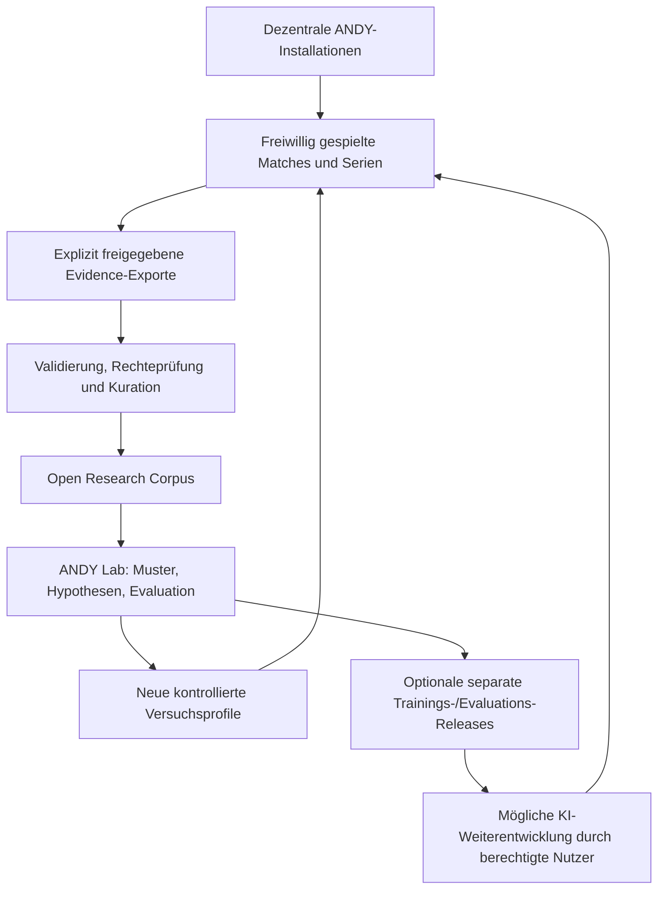

# ANDY – Dezentrale Erkenntnisökonomie
## GAME 4 LAB → LAB 4 AI → AI 4 GAME

**Memo V0.1 · 14.11.2026 · Strategische Perspektive / Diskussionsgrundlage**

Dieses eigenständige Memo hält eine im App-Thread entwickelte Perspektive fest: ANDY könnte nicht nur eine Arena und ein Forschungsinstrument sein, sondern ein dezentrales Netzwerk, in dem freiwillig gespielte Partien wirtschaftliche Nachfrage und wissenschaftlich nutzbare Daten erzeugen. Keine beschlossene Monetarisierung, keine Anbieterzusage, keine freigegebene Trainingsdatensammlung. Der Masterplan hat weiterhin Vorrang.

## 1. Ausgangspunkt: Entertainment finanziert Datenerzeugung

Die Projektleitung berichtet aus dem eigenen aktuellen Spielbetrieb von API-Kosten in der Größenordnung von **2–5 EUR je Partie**, insbesondere bei leistungsstarken Modellen. Dies ist eine Erfahrungsangabe, kein verifizierter Durchschnitt, kein Anbieterpreis und keine allgemeine Kostengarantie. Modellwahl, Eingabe-/Ausgabe-Token, Reasoning, Cache, Korrekturversuche, Tarif, Wechselkurs und Verlauf bestimmen die tatsächlich abgerechneten Kosten.

Wenn viele Menschen ANDY lokal spielen, Rückkämpfe austragen und Versuchsprofile variieren, entsteht Nachfrage nach KI-APIs. Die Spieler finanzieren dabei möglicherweise einen Teil der Erzeugung von Forschungsdaten durch ihr eigenes Spielinteresse. Entscheidend ist freiwillige Teilnahme und bewusst freigegebene Kosten, nicht eine Maximierung des Tokenverbrauchs.

### Illustrative Skalierung (konstante 2–5 EUR je Partie)

| Partien pro Monat | Hypothetische aggregierte API-Ausgaben pro Monat |
|---:|---:|
| 100 | 200–500 EUR |
| 1.000 | 2.000–5.000 EUR |
| 10.000 | 20.000–50.000 EUR |
| 100.000 | 200.000–500.000 EUR |

Reine Szenariorechnung, keine Nachfrageprognose und keine Aussage über Margen, Gewinne, Marktanteile oder ANDY-Erlöse. Bei API-Zwischenhändlern ist die Zuordnung der Ausgaben zum einzelnen Anbieter gesondert zu prüfen.

## 2. Dreifacher potenzieller Nutzen für KI-Anbieter

- **Wirtschaftlich:** zusätzliche API-Nachfrage durch Spielbetrieb, Rückkämpfe und kontrollierte Experimente.
- **Kommunikativ:** Modelle werden in einem nachvollziehbaren Wettbewerb mit konkreten Handlungen und Konsequenzen öffentlich erlebbar.
- **Wissenschaftlich:** systematisch dokumentierte Interaktionen können Stärken, Schwächen, Fehlerkorrektur, Ressourceneffizienz und Anpassung an veränderte Bedingungen untersuchbar machen.

Die Pointe des Gesprächs: Anbieter könnten wirtschaftlich von Aktivitäten profitieren, die zugleich Erkenntnisse für ihre eigene Modellentwicklung liefern. Diese Interessenüberschneidung ist eine Kooperationshypothese, kein nachgewiesener Nutzen für einen bestimmten Anbieter. ANDY schuldet weder eine positive Modellbewertung noch bevorzugte Ergebnisse.

## 3. Dezentrale Datenerzeugung, gemeinsame Evidenz

**GAME 4 LAB → LAB 4 AI → AI 4 GAME.**

Vorhandene Basis: [App-Lab-Übergabe und Evidence Builder](ANDY_APP_LAB_SERIES_HANDOFF_2026-11-14.md), [Evidenzvertrag](ANDY_MATCH_EVIDENCE_JSONL_JSON_SQLITE_v1.0.md), [Research Pipeline](ANDY_SERIES_RESEARCH_PIPELINE_SPEC_v0.1.md) und [Lab CORE](../research/andy-lab/CORE/v0.1/README.md).

Die App erzeugt bereits portable Serien-Evidenzpakete mit Original-JSONL, JSON-Berichten, Manifest/Prüfsummen, Audit und normalisiertem Matchindex. Ein künftiger dezentraler Import benötigt dagegen eine gesonderte Infrastruktur und Governance. GitHub ist ein möglicher Einstieg für versionierte Spezifikationen, Indizes, freigegebene Daten und Releases; bei größerem Volumen sind geeignete Datenspeicher mit stabilen Referenzen zu prüfen. Keine automatische Veröffentlichung aus lokalen Installationen.

### Mindestanforderungen für Beiträge

- Freiwillige, informierte Freigabe durch den Beitragenden; klare Erklärung, welche Inhalte veröffentlicht werden und welche späteren Nutzungen zulässig sind. Veröffentlichung und Trainingsfreigabe unterscheiden.
- Eindeutige Match-/Serien-/Segmentidentität, Quellhashes, Variantenprofil, Regel-/Engine-Version, Provider und tatsächlich belegte Modellversionen; unbekannte Werte explizit kennzeichnen.
- Originale unverändert, geschützte oder redigierte Veröffentlichungsderivate eindeutig gekennzeichnet. Keine Schlüssel, privaten Pfade, personenbezogenen Daten oder vertraulichen Prompts öffentlich ablegen.
- Validierung der Züge und Ergebnisableitung, Dubletten-/Manipulationsprüfung, nachvollziehbare Herkunft und Versionierung. Prüfsummen belegen Integrität, nicht allein Authentizität oder Spielrichtigkeit.
- Unterschiede zwischen API-Anbindungen, Tarifen, Modellständen, Regeln und Einstellungen erhalten; keine unkontrollierte Vermischung von Forschungskohorten. Abbrüche und Verluste nicht ausfiltern, wenn sie für die Fragestellung relevant sind.

## 4. Potenzieller Wert für KI-Training und Evaluation

ANDY könnte Datensätze liefern, die über isolierte Frage-Antwort-Paare hinausgehen:

| Datentyp | Mögliche Forschungs- oder Lernaufgabe |
|---|---|
| Zustand, Aktion, legaler/illegaler Zug, Folgezustand | Regelkonformes Handeln und zustandsbezogene Vorhersage |
| Mehrstufige Matchtrajektorien | Langfristige Handlungsplanung und Reaktion auf Gegenmaßnahmen |
| Fehler, Feedback, Korrekturversuche | Lernen aus Fehlern und Bewertung von Korrekturstrategien |
| Tokenkonten, Budget, Laufzeit und Ergebnis | Ressourcenbewusste Entscheidungen; Effektivität vs. Effizienz |
| Farbtausch, Self-Play, kontrollierte Profilvariation | Robuste Vergleiche und wiederkehrende Interaktionsmuster |
| Gewonnene, verlorene und unterbrochene Partien | Erfolgs- und Misserfolgsmuster, einschließlich technischer Ausfälle |

Die tatsächlich ausgeführte Aktion, der verifizierbare Folgezustand und das Spielergebnis sind andere Evidenzarten als die textliche Modellbegründung. Begründungstexte sind keine Messung innerer Denkprozesse. Ein Sieg beweist nicht die Optimalität vorheriger Züge; eine Niederlage beweist nicht, dass jeder Zug schlecht war. Alternativen müssen regelgeprüft und als kontrafaktisch gekennzeichnet werden. Trainingswert und Transfer auf andere Aufgaben sind noch zu evaluieren.

Illustrativer Fall aus dem aktuellen Forschungsbetrieb: Bei Match `andy_59aeba2a8d3b` (Gemini 4 Argon × Claude Opus 5.5, 350.000 Tokens je Seite) berichtete die Projektleitung nach zwischenzeitlicher deutlicher Go-Führung von Opus einen TKO-Sieg für Argon. Diese Beobachtung motiviert Fragen zur Ressourcenadaptivität und zum Verhältnis von Effektivität und Effizienz. Unabhängige Endauswertung anhand des vollständigen Originalpaars bleibt Voraussetzung für belastbare Aussagen. Der Fall ist kein allgemeiner Nachweis einer Modellüberlegenheit.

### Trainingsdaten sind ein eigener Freigabeschritt

Eine öffentliche Matchdatei ist nicht automatisch ein rechtlich nutzbarer oder hochwertiger Trainingsdatensatz. Vor jedem Trainings-/Evaluations-Release:

1. Anwendbare Providerbedingungen (inkl. Output-Nutzung und ggf. Einschränkungen für Modellentwicklung), Rechte der Beitragenden, Datenschutz und geeignete Lizenz klären.
2. Zweck, Qualität, Abdeckung, Fehlerstatus und Provenienz dokumentieren; repräsentative Auswahl statt ausschließlich spektakulärer Siege.
3. Trainings-, Validierungs- und Testdaten strikt trennen; zusammenhängende Resume-Segmente, Serien, nahe Varianten und Duplikate möglichst derselben Partition zuordnen. Kontamination öffentlicher Evaluationen berücksichtigen; unabhängige Holdouts vorsehen.
4. Nutzen durch kontrollierte Evaluation prüfen; keine automatische Übernahme von Modellaussagen, Siegerlabels oder hypothetischen Zügen als Trainingswahrheit.

Nicht behaupten, dass ChatGPT oder andere Modelle aus den veröffentlichten Daten automatisch oder unmittelbar lernen. Eine tatsächliche spätere Trainingsnutzung ist Entscheidung und Verantwortung der jeweiligen berechtigten Akteure.

## 5. Kooperationsperspektive: Anbieter als mögliche Förderer

Ein zukünftiges Modell könnte freiwillige API-Guthaben, Forschungsbudgets, gesponserte Serien oder Turniere umfassen. Anbieter tragen einen Teil der Spielkosten; ANDY stellt die Arena, ein transparentes Regelwerk und unabhängige Evidenzaufbereitung bereit. Zuschauer könnten freigegebene Live-Ansichten und Replays ohne eigenen KI-Aufruf verfolgen.

Leitplanken: Sponsoring offenlegen; gleiche Spielregeln und offen deklarierte Versuchsprofile; keine Einflussnahme auf Siegerermittlung, Datenwahl, negative Resultate oder Veröffentlichung; keine Exklusivität oder Anbieterkooperation unterstellen. Kostenlimits, Stoppmöglichkeiten und ausdrückliche Startfreigabe vor kostenpflichtigen Matches. Keine Anreize für künstlich aufgeblähte Tokenverbräuche. Hohe Kosten sind keine Leistungsmetrik.

## 6. Sinnvolle nächste Schritte – noch nicht beauftragt

- Pilotkorpus aus eigenen freigegebenen Partien zunächst qualitätsgesichert erweitern; tatsächliche API-Ausgaben und Tokenverbrauch getrennt erfassen.
- Beitragsspezifikation für dezentrale Installationen entwickeln: Exportversion, Metadaten, Rechte-/Freigabenachweis, Prüfstatus und Importprotokoll.
- Kleinen freiwilligen dezentralen Pilot mit reproduzierbarer Prüfung durchführen; erst dann Skalierung und geeignete Infrastruktur entscheiden.
- Mit dem Lab ermitteln, welche Datenfelder und Trajektorien tatsächlich für Evaluation oder Training sinnvoll sind; ggf. separate versionierte Datensatz-Releases vorbereiten.
- Bei belegter Qualität und tragfähigem Kostenmodell mögliche Anbieterkooperationen erörtern.

**Strategischer Kern:** Nicht das Spiel ist allein das Produkt. Der potenzielle Mehrwert entsteht aus der Verbindung von Spielerlebnis, freiwilliger verteilter Datenerzeugung und unabhängigem Erkenntnisgewinn. Die wissenschaftliche und wirtschaftliche Tragfähigkeit dieser Vision bleibt zu prüfen.
