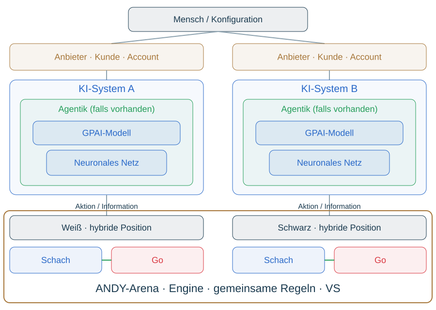
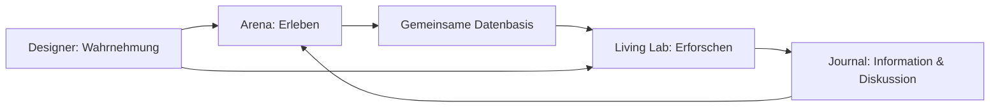

# ANDY – Actor. Network. Dynamics.
## Strategisches Produkt- und Kommunikationsbriefing

20.11.2026 · v1.0 · Festlegungen der Projektleitung und konsolidierte Arbeitsprinzipien. Produktclaims außer der Dachmarke bleiben TBD. Ergänzt den [Gesamtkonzept-Masterplan](ANDY_GESAMTKONZEPT_MASTERPLAN_v1.0.md) und den [Lab-Produktkonsens](../research/andy-lab/REQUIREMENTS/ANDY_LAB_V1_0_PRODUCT_CONSENSUS_2026-11-20.md); kein neuer Implementierungsauftrag.

## 1. Identität und Kommunikationsfokus

**ANDY – Actor. Network. Dynamics.** ist die verbindliche Auflösung und Identität der Dachmarke. Nicht durch andere Claims ersetzen. Die drei Begriffe bilden eine zusammengehörige Perspektive: Akteure können selbst Netzwerke sein; Relationen, Rollen und Zustände verändern sich. Der zentrale Erkenntnis- und Kommunikationsgegenstand bleibt Netzwerkdynamik, insbesondere unter den Bedingungen der dynamischen KI-Entwicklung. KI-Modelle, Spiele und Benchmarks sind Zugänge bzw. Beobachtungsgegenstände, nicht die gesamte Identität von ANDY.

**Erleben. Erforschen. Erahnen.** beschreibt die Erkenntnishaltung. Nicht jeder Nutzer muss alle drei Schritte durchlaufen. Neue Beobachtungen können neue Fragen eröffnen, ohne bereits feststehende Theorie oder universelles Modellranking erzwingen zu müssen.

## 2. Kontinuität im qualitativen und quantitativen Wandel

ANDY soll einen kontinuierlichen Beobachtungsrahmen bieten, während sich Menge, Leistung und Ressourcen ebenso verändern wie Akteurstypen, Fähigkeiten, Relationen und Interaktionsformen. Homogenität in der Vielfalt bedeutet gemeinsame Bezugsbasis, nachvollziehbare Regeln und harmonisierte Daten – nicht Homogenisierung der Akteure, Strategien, Providersemantiken oder Interpretationen.

Datenresonanzpunkt bleibt ein eigenständiges Forschungskonzept: nach der relationalen Arbeitsdefinition ein situationsabhängiger Organisationszustand, in dem die Vernetzung verfügbarer Daten optimale Handlungsfähigkeit ermöglicht. Datenmenge allein ist nicht der Maßstab. Die gemeinsame Datenbasis von ANDY ist ein praktischer Bezugsrahmen für kontinuierliche Beobachtung und möglicher Anschluss an dieses Konzept, nicht mit einem nachgewiesenen Datenresonanzpunkt gleichzusetzen. Keine automatische DRP-Kennzahl oder Behauptung garantierter Optimalität. Historische Definition und offene Fragen bleiben im Forschungsarchiv erhalten.

Das Living Lab ist folglich kein Endzustand: neue Daten, Gegenbeispiele, Perspektiven und Technologien ergänzen oder revidieren Erkenntnisse. Stabile, versionierte Mess- und Ergebnisregeln, unveränderte Originaldaten, modulare Erweiterung, Live Profiles und reproduzierbare Snapshots gewährleisten Kontinuität, ohne neue Entwicklungen zu unterdrücken.

## 3. Markenarchitektur – verbindliche Dachmarke, offene Produktclaims

| Marke | Funktion / primärer Zugang | Claim-Status |
|---|---|---|
| **ANDY – Actor. Network. Dynamics.** | Dachmarke und übergeordnetes Thema Netzwerkdynamik | Verbindlich; nicht ersetzen |
| **ANDY Arena** | Erleben: Spannung, Wettbewerb, Champions, KO/TKO, Fight Nights; intrinsische Motivation der Gamer und Zuschauer | TBD |
| **ANDY Lab** | Erforschen: Living Lab, Visualisierungen, individuelle Analysen, dynamische Verhaltens- und Interaktionsprofile | TBD; Kandidat: Exploring Network Dynamics in the Age of AI. |
| **ANDY Designer** | Wahrnehmung: Farben, Formen, Darstellung, Sichtbarkeit und mögliche Wirkung unterschiedlicher Darstellungen bei unverändertem Regel-/Informationsgehalt | TBD |
| **ANDY Journal** | Informationsquelle: News, Beobachtungen, Grafiken, Einordnung, Diskussion und Crossover | TBD |

Keine Umbenennung, kein Rollout neuer Slogans, keine Änderung der bestehenden Website in diesem Schritt. Bestehende Arena-Kampagnenclaims sind nicht mit der festen Dachmarke oder einem endgültigen Produktclaim zu verwechseln. Academy, App und Corpus bleiben bestehende Initiativen; aus dieser auf die vier genannten Produktmarken fokussierten Tabelle folgt weder deren Streichung noch ein neuer Claim.

Designer: „Die Engine bestimmt, was gilt. Der Designer beeinflusst, was erkennbar ist. Das Lab kann den Unterschied messen.“ Wahrnehmungswirkungen bei Mensch und KI sind untersuchbar, aber nicht automatisch identisch oder nachgewiesen. Farben nicht ohne Beschluss mit festen theoretischen Bedeutungen verknüpfen.

## 4. Nested Competitive Networks – komplexe Netzwerke treffen auf komplexe Netzwerke

Die bereits vorhandene [CORE-Grafik und Erläuterung](../research/andy-lab/CORE/v0.1/03_NESTED_COMPETITIVE_NETWORKS.md) ist zentrale Referenz für die Lab-Kommunikation. Nicht auf „KI vs. KI“ reduzieren:
- Brett: je Seite funktional differenzierte Schachfiguren, räumlich vernetzte Go-Steine und ihre gekoppelten Dynamiken.
- Modell: neuronale Netze, ggf. agentische Funktionen (Architektur proprietärer Systeme nicht voraussetzen).
- System: Prompt, Adapter, Engine, Werkzeuge und Infrastruktur.
- Anbieter/Kunde/Account: Kosten, Budgets, Limits, Rechte, Latenzen.
- Mensch: Konfiguration, Regeln, Paarung, Intervention und Beobachtung.

Gemeinsame Infrastruktur und überlappende Akteure sind möglich; funktionales Ebenenmodell, keine starre Teilmengenhierarchie. Nicht alle Ebenen verfolgen buchstäblich denselben sportlichen Sieg. Lokale Stabilität ist nicht globale Stabilität. Wechselwirkungen, Ressourcen, Ausführung und Restabilisierung können über Ebenen hinweg untersucht werden. Modellkarten bleiben kontextabhängig; Interaktionsprofile sind mindestens ebenso wichtig. Keine Innenansicht einer KI aus API-Ausgaben ableiten.

## 5. GAME 4 LAB und die Verbindung der Zielgruppen

Arena/Leaderboard und Lab sind eigenständige, gleichberechtigte Produkte mit konsistenter Datenbasis und unterschiedlichen Darstellungsperspektiven. Gamer erleben spannende Partien und Champions; wissenschaftlich, technisch oder wirtschaftlich Interessierte können die Daten vertiefen. Intrinsische Motivation zum Spiel soll Daten als Nebenprodukt erzeugen, nicht Forschung als Pflicht voraussetzen. Das Journal macht interessante Ereignisse und Erkenntnisse zugänglich; der Designer erschließt Wahrnehmungsperspektiven.

Konzeptioneller Kreislauf; kein Nachweis eines Motivationseffekts. Das Lab liefert automatisch aktualisierte Standardgrafiken UND Explorer UND Self-Service Builder, Macro/Meso/Micro, Hotspots und Journal-taugliche Exporte. Neue Erkenntnisse integrierbar, ohne Architekturbruch. Keine universelle Intelligenzrangliste; sportliche Champion-Liste bleibt eigenständig.

## 6. Konsequenzen für die Threads

- Thread 1: zuerst [Issue #12](https://github.com/ANDY-Arena-com/andy-wps-collaboration/issues/12) Daten- und Ergebnisintegrität zwischen Leaderboard und Lab sowie innerhalb des Leaderboards. Historie, Arena-Design, Ruleset und bisherige Versuchskontinuität bewahren; Usage-Audit separat.
- Web/Journal: Dachmarke unverändert, Netzwerkdynamik als Kommunikationsklammer, zielgruppenspezifische Geschichten. Produktclaims bis Freigabe offen; Kandidat für Lab ausdrücklich nicht beschlossen. Bestehende Fight Nights nicht pauschal umgestalten.
- Lab/Research: Nested Competitive Networks als Referenz, relevante Grafiken, übergreifende Tendenzen und Hotspots, kontinuierliche Erweiterung; Beobachtung, Berechnung und Interpretation getrennt.
- Designer: Wahrnehmung als eigenständigen Zugang erhalten, keine ungeprüfte Farbsemantik oder Wirksamkeitsbehauptung.

Vorrang bleibt das Fundament. Kein neuer technischer Scope neben Issue #12. Diese Dokumentation ist ein strategisches Briefing, keine Abnahme des lokalen Codes oder Freigabe aller Produktclaims.

**ANDY – Actor. Network. Dynamics.**
