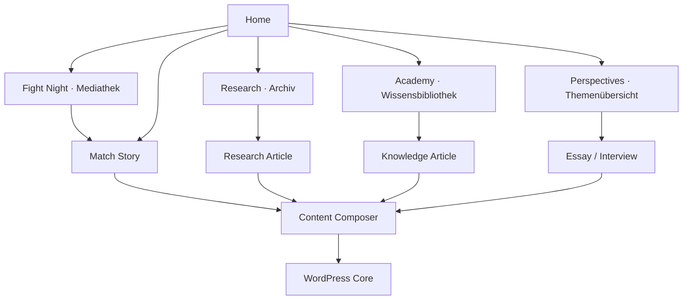
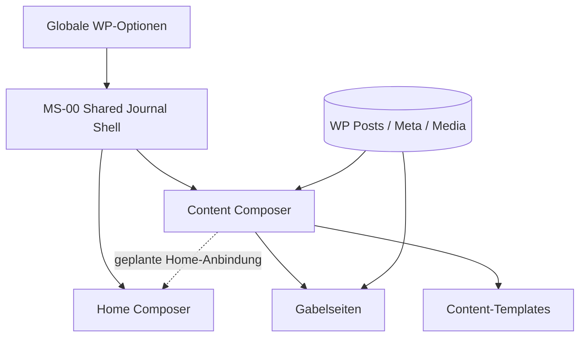
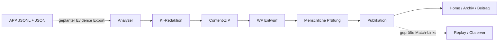

# ANDY Journal — WordPress Architecture Baseline R0.2
**24.11.2026 | Journal v1.1 | Architekturvereinbarung / Paketstand, keine Live-Freigabe**

## WP-ARCH-01 — Informationsarchitektur

Home ist kuratierte Bühne; Gabelseiten sind dynamische Sammlungen; Contentseiten sind individuelle Beiträge. Direkte Links Home → Beitrag sind zulässig. Alle veröffentlichten freigegebenen Beiträge eines Bereichs erscheinen im Archiv, Home nur nach expliziter Freigabe. Mediathek-Design separat; technische Funktion zuerst.

## WP-ARCH-02 — Shared Journal Shell und Datenfluss

Ein Renderer, gemeinsame CSS-/JS-Assets, keine Header-Kopien als Ziel. Höhe, Transparenz, Hintergrund, Logo, Schriftzug/Position, Claim, Breite, Sprache, Suche, Menü, Sticky, responsive Verhalten und Beta-Kennung zentral pflegen. Home-Hero-Overlay darf kontextabhängig sein; Artikel beginnen unter dem Header. Footer perspektivisch zentral. Derzeit liegt MS-00 im Home Composer; ein Core-Plugin ist optional, nicht beschlossen. Bestehenden Fallback bei fehlendem Home-Plugin nicht als zweite Designquelle weiterentwickeln.

## WP-ARCH-03 — WP-Verankerungen (Paketstand 0.1.24 / 0.1.6)
Aus den gelieferten ZIPs statisch gelesen, nicht Hostinger-Runtime.
| Funktion | Verankerung |
|---|---|
| Home | andy-home-composer/andy-home-composer.php; assets/composer.css; assets/composer.js |
| Globale Konfiguration | andy_home_composer_header_v01; andy_home_composer_config_v01; andy_home_composer_public_v01 |
| Shared Header | andy_hc_shared_header_assets(); andy_hc_shared_header_render(); window.ANDY_HC.headerOnly |
| Content | andy-journal-content-composer/andy-journal-content-composer.php; includes/class-andy-cc-header.php; andy_cc_render_site_header() |
| Template-Routing | template_include (99); _andy_cc_template; templates/single-andy-cc.php; templates/single-fightnight.php |
| Content-Design | andy_cc_themes_v01; _andy_cc_overrides; _andy_cc_image_mode; assets/content.css; assets/fightnight.css |
| Import / Administration | includes/class-andy-cc-importer.php; includes/class-andy-cc-admin.php; includes/fightnight.php; _andy_cc_package_id |
| Fight Night | _andy_cc_fn_data; _andy_cc_fn_home; _andy_cc_fn_featured; _andy_cc_fn_observer; _andy_cc_fn_links_approved; _andy_cc_fn_internal |
| Archiv | andy_cc_fn_query_args(); andy_cc_fn_archive_url(); ?andy_fightnight_archive=1; template_redirect (-100); templates/archive-fightnight.php |
| Home-Datenvertrag | andy_cc_fn_home_stories($limit=60); Home liefert aktuell noch andy_hc_fn_demo_data() |
| Academy | andy_cc_registered_renderers Filter; _andy_cc_renderer; _andy_cc_renderer_version; _andy_cc_lesson_data |
Native WP-Beiträge, Titel, Excerpt, Body, Beitragsbild, Permalink und Post Meta sind führend für redaktionelle Inhalte. Keine neue parallele Datenbank. Home-Optionen halten Layout/Kuration, keine doppelte Story-Kopie. Taxonomien und generische Bereichsfreigabe sind Ziel, keine behauptete vorhandene Registrierung.

## WP-ARCH-04 — Modul-Sets und Wiederverwendung
| ID | Verantwortung |
|---|---|
| MS-00 | Shared Shell |
| MS-01 | Home: Hero, Themenbühnen, Teaser |
| MS-02 | Gabelseiten: Sammlung, Karten; Suche/Filter später |
| MS-03 | Content Core: Titel, Bild, Text, Quellen, Beziehungen |
| MS-04 | Fight Night: Fakten, Kontrahenten, Brett, Szenen, Replay |
| MS-05 | Academy: Lernziele, Erklärungen, geprüfte Renderer |
| MS-06 | Research: Frage, Methodik, Evidenz, Diagramme, Observer |
| MS-07 | Perspectives: Essay, Interview, Mensch-KI-Co-Creation |
| MS-08 | Social: Reel / Landingpage (Konzept) |
| MS-09 | Redaktion: Import, Validierung, Vorschau, Freigabe |
IDs sind Dokumentationskonvention, keine Code-IDs. Drei Schichten: globale Shell, gemeinsamer Content Core, bereichsspezifische Feature-Module. Fight Night als End-to-End-Referenz zuerst; Research übernimmt technische Mechanik statt Code zu kopieren. Je Bereich eigener Home-Teaser, Archiv, Content-Template, Datenfelder und Gestaltung. Standard-Template für freie Beiträge bleibt bestehen.

## WP-ARCH-05 — APP / Redaktion / CMS

APP-Originale bleiben führende Evidenz, SQLite ist abgeleitet (APP Architecture R0.1 vom 23.11., ARCH-02/05). KI erstellt Titel, Teaser, Warum ansehen, Naturmotiv, Report und Szenenauswahl; Fakten aus Originaldaten, Brett aus validiertem Zustand; Mensch prüft und veröffentlicht. Match-ID und Story-ID getrennt. ZIP-Vertrag: versioniertes Manifest, Story, Artikel, Bild, Metadaten, Positionsreferenzen, Freigabestatus; konkrete endgültige Schema-Version nach Integration festlegen. Keine ausführbaren Importdateien, keine Schlüssel oder gesperrten Originale veröffentlichen. Replay/Observer nur passend und freigegeben; keine falschen Links. Transparenz-Expander: Datum, technische Umgebung, Provider, Modell-ID, Originalquellen, GitHub/Commit, Regelversion, Einschränkungen. Unbekanntes nicht erfinden. Neutralität, keine Modellpräferenz, Beobachtung vs. Interpretation; Nature of Competition ohne feste Tierzuordnung. Große Weiß-/Schwarz-König-und-Stein-Symbole an Match und Brett.

## WP-ARCH-06 — Status und Release-Gates
| Bereich | Status |
|---|---|
| Home 0.1.23 / CONTENT-08 | Design vom Nutzer akzeptiert |
| Content 0.1.3 | Import und Archiv anhand Nutzer-Screenshots erprobt |
| Content 0.1.4 | Aktivierungsfehler gemeldet; 0.1.5 Korrektur geliefert |
| Home 0.1.24 + Content 0.1.6 | Shared Header im Paket; Live-Abnahme offen |
| Home-Datenanbindung | Offen; Content-Abfrage vorhanden |
| Mediathek-Design / Research E2E / weitere Gabelseiten | Geplant |
| APP Evidence Export / finale Editorial Bible / Social | Geplant |
Abnahme: Backup, korrekter Plugin-Ordner, PHP/JS-Syntax, Aktivierung, Browservergleich Header auf Home/Content/Archiv (Desktop/Mobil), Änderung globaler Einstellungen, Menü/Sprache/Suche, drei importierte Beiträge, vierter Home-freigegebener Beitrag erscheint automatisch, fünfter nur Archiv, Checkbox aus entfernt nur Home, Titel/Bild/Teaser-Änderung propagiert, Entwürfe und interne Medien nicht öffentlich, richtige Replay-Links, Regression anderer Module, Cache und Rollback prüfen. Ergebnisse PASS/FAIL/NOT RUN dokumentieren; keine produktive Gleichheit aus ZIP ableiten.
Nächste Schritte: Shared Header abnehmen → Fight Night Home anbinden → E2E testen → generischen Content Core extrahieren → Research und weitere Bereiche → Mediathek-Design / Editorial Bible finalisieren.
**Prinzip: Standardisieren, was technisch gleich ist. Individualisieren, was Menschen erleben sollen. Co-Creation Mensch und KI als Kern von ANDY.**
