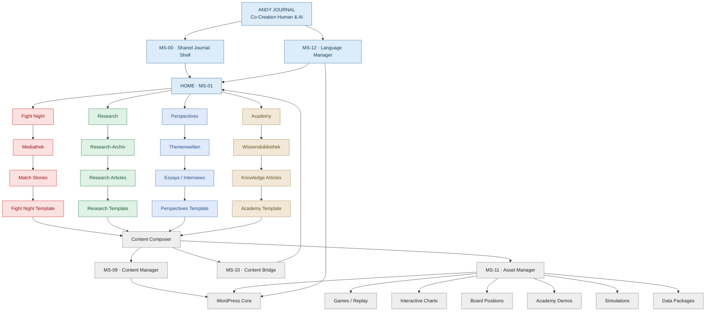
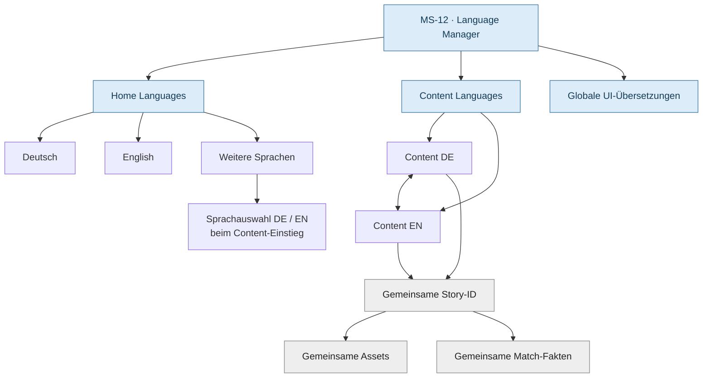
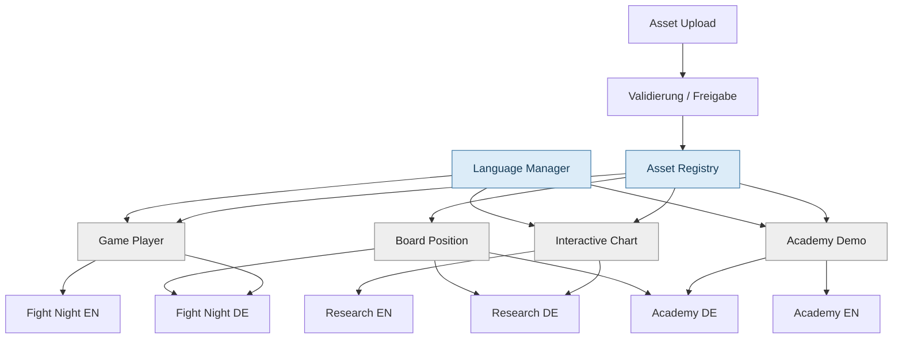

# ANDY JOURNAL · WP-ARCH R0.3
**24.11.2026 | Journal v1.1 | Architekturvereinbarung und Zielbild, keine Live-Freigabe**

Fortschreibung von [R0.2](WP-ARCHITECTURE-R0.2.md). ANDY: Co-Creation Human & AI. Erleben. Erforschen. Erahnen. Die drei menschlichen Zugänge sind nicht zwingend identisch mit technischen Content-Kategorien. Design, Geschichten, Sprachen, interaktive Assets und Originaldaten werden unabhängig verwaltet und auf Contentseiten zusammengeführt.

## 1. Mermaid-Gesamtarchitektur

Logische Zielarchitektur. Fight Night ist erprobte Referenz. Asset Manager, Language Manager und weitere Bereichsketten sind noch zu entwickeln. Home darf auch direkt auf Beiträge verlinken. Veröffentlichte Beiträge erscheinen automatisch in der Bereichssammlung; Home nur nach Freigabe. Mediathek-Design separat. Shared Shell funktional vom Nutzer abgenommen; Transparenzverlauf später.

## 2. Die drei Dimensionen
| Erleben. | Erforschen. | Erahnen. |
|---|---|---|
| Spiel, Wettbewerb, Spannung | Evidenz, Analyse, Erkenntnis | Intuition, Zukunft, Reflexion |
| Fight Night, Replay, interaktive Spiele | Research, Observer, Experimente | Perspectives, Diskurs, Co-Creation |

Academy: verbindendes Wissen für alle drei Erlebniswelten; ein Research-Artikel und eine Matchstory können dieselbe Academy-Demonstration referenzieren. Keine Festlegung des endgültigen Home-Designs.

## 3. Content-Kategorien und individuelle Templates
| Kategorie | Content-Typ | Spezifische Module |
|---|---|---|
| Fight Night | Match Story | Kontrahenten, Facts, Brett, Szenen |
| Fight Night | Match Series | Mehrere Partien, Vergleich, Verlauf |
| Fight Night | Interactive Game | Spiel oder Replay-Player |
| Research | Research Article | Methodik, Evidenz, Ergebnisse |
| Research | Interactive Analysis | Filter, Grafiken, Observer |
| Research | Experiment | Hypothesen, Simulationen |
| Research | Model Comparison | Vergleichende Kennzahlen |
| Academy | Knowledge Article | Erklärungen, Grundlagen |
| Academy | Interactive Lesson | Demozüge, Lernschritte |
| Academy | Tutorial | Anleitung, Übungen |
| Perspectives | Essay | Reflexion, Argumentation |
| Perspectives | Interview | Mensch-KI-Dialog |
| Perspectives | Co-Creation | Gemeinsame kreative Projekte |
| Perspectives | Future Scenario | Szenarien und Gedankenexperimente |
| Allgemein | Standard Content | Freie redaktionelle Gestaltung |

Templates sind Kombinationen aus globalen, allgemeinen und spezifischen Modulen, keine 15 unabhängigen Codebasen. End-to-End je Bereich: Home-Modul → Gabelseite → individueller Beitrag → Template → WP. R0.2 dokumentiert die bestehenden konkreten PHP-/CSS-/JS-Verankerungen.

## 4. MS-12 · Language Manager
Deutsch und Englisch für das gesamte Journal. Weitere Sprachen ausschließlich auf der Home.

| Bestandteil | DE | EN | Weitere Sprachen |
|---|---|---|---|
| Home | Ja | Ja | Ja |
| Globale Navigation | Ja | Ja | Auf Home |
| Gabelseiten | Ja | Ja | Nein |
| Fight Night | Ja | Ja | Nein |
| Research | Ja | Ja | Nein |
| Academy | Ja | Ja | Nein |
| Perspectives | Ja | Ja | Nein |
| Interaktive Assets | Ja | Ja | Optional |
| Originaldaten | Sprachunabhängig | Sprachunabhängig | Sprachunabhängig |

Home-Sprachwechsel auf z.B. FR/ES (nur Beispiele, keine abschließende Sprachliste) ändert Home-Texte. Beim Einstieg in Content aus einer weiteren Sprache stehen Deutsch/English zur Auswahl. Auf Content und Gabelseiten nur DE/EN; Wechsel zur korrespondierenden Sprachfassung derselben Story.

## 5. Sprachübergreifende Datenverantwortung
| Gemeinsam | DE / EN separat |
|---|---|
| Story-ID, Match-ID | Titel, Teaser |
| Key Visual, Logos, Modellnamen | Matchreport, Szenenbeschreibungen |
| Spielfarben, Kennzahlen | Bildunterschriften, SEO-Metadaten |
| Original-JSONL, Brettzustände, Replay-Daten | Redaktionelle Sprachfassung |
Buttons und Navigation: zentrales Sprachwörterbuch. Eine Story, zwei redaktionelle Sprachfassungen, eine gemeinsame Faktenbasis. Sprachfassungen können eigene WP-Post-IDs haben; gemeinsame Story-ID und eindeutige Kombination Story-ID + Sprache verhindern unkontrollierte Dubletten. Veröffentlichung unabhängig möglich. Fehlende Übersetzung nicht als vorhanden ausgeben.

## 6. MS-11 · Content Asset Manager

Ein Asset, mehrere Verwendungen, mehrere Sprachfassungen. Upload-Inventar und Rückwärtszuordnung: was hochgeladen, wo verwendet, welche Version. Typen: Game Player, Guided Tour, Board Position, Academy Demo, Interactive Chart, Research Tool, Data Package, Simulation, External App. Normale Medien bleiben in WP-Mediathek. Registry: Asset-ID, Typ, Version, Upload-Datum, Quelldatei, Prüfsumme, Post-IDs, Einbauposition, optionale Match-ID, Herkunft, technische und redaktionelle Freigabe, unterstützte Sprachen, Standard-/Ersatzsprache, lokalisierte Beschriftungen. Versionsgebundene Referenzen und Verwendungsübersicht über alle Sprachfassungen.
Vorgeschlagene Verzeichnisstruktur: andy-content-assets/{games,academy,charts,research,positions,simulations,data}/<Asset-ID>/<Version>/. Private Quellen und ungeprüfte Uploads außerhalb öffentlicher Webverzeichnisse. Kein serverseitig ausführbarer Code aus Content-Uploads; HTML/JS nur isoliert nach Prüfung. Keine Freigabe gesperrter Originaldaten.

## 7. Zukünftiges Content-ZIP
```text
ANDY-CONTENT-STORY.zip
  manifest.json          # Story-ID, Kategorie, Content-Typ, Schema-Version
  shared/               # Fakten, Match-Metadaten, Quellen, Asset-Referenzen
  media/                # Key Visual, gemeinsame Bilder
  languages/de/         # Titel, Teaser, Artikel, Szenentexte, SEO
  languages/en/         # Title, teaser, article, scene descriptions, SEO
  assets/               # optionale neue interaktive Komponenten zur Prüfung
  editorial-check.json  # Evidenzprüfung, Herkunft, Freigabestatus
```
Vorschlag, noch kein aktuell importierbares Format. DE kann zuerst abgenommen, EN später hinzugefügt werden. Ein erneuter Import derselben Story/Sprache erzeugt nicht automatisch einen weiteren Beitrag. Menschliche Freigabe bleibt erforderlich. Asset-Referenzen enthalten Asset-ID, Version, Rolle und Einbauposition. APP-Originale bleiben führend; keine erfundenen Fakten oder Replay-Verknüpfungen.

## 8. Modulregister R0.3
| ID | Modul-Set | Status |
|---|---|---|
| MS-00 | Shared Journal Shell | Funktional abgenommen (Nutzer) |
| MS-01 | Home Composer | Erprobt |
| MS-02 | Gabelseiten | Technische Basis |
| MS-03 | Shared Content Core | Weiterentwickeln |
| MS-04 | Fight Night | Erprobt |
| MS-05 | Academy | Teilweise vorhanden |
| MS-06 | Research | Ausbauen |
| MS-07 | Perspectives | Geplant |
| MS-08 | Social Media | Konzept |
| MS-09 | Content Manager | Erprobt |
| MS-10 | Content Bridge | Erprobt |
| MS-11 | Content Asset Manager | Neu |
| MS-12 | Language Manager | Neu |
| MS-13 | Evidence Bridge APP / Journal | Geplant |
| MS-14 | Editorial Studio | Geplant |
Paketbaseline: Home Composer 0.1.26 / Content Composer 0.1.7; tatsächlicher Live-Stand nicht unabhängig geprüft. Content-Persistenz und Wachstumstest bleiben offen. Modul-IDs sind Dokumentationskonventionen, keine behaupteten Code-IDs.

## 9. Reihenfolge
1. Content Asset Manager: Uploads, Verzeichnisstruktur, Inventar, Zuordnung, sichere Freigabe.
2. Language Manager: DE/EN-Verknüpfung, zentrale Sprachwahl, Home-Sondersprachen.
3. Gemeinsamer Content-Datenvertrag: Sprachfassungen, Asset-Referenzen, gemeinsame Fakten und Identitäten.
4. Content Composer 0.2.0: Integration der neuen Datenstruktur und Importfunktionen.
5. Editorial Bible: verbindliche Produktionsanleitung für KI-Redaktionen.
6. FIRST COMPLETE STORY: erste echte zweisprachige Matchstory mit interaktiven Assets.
7. Research End-to-End: Wiederverwendung der bewährten Architektur mit eigenen Content-Modulen.

## 10. Ergänzung: Sprachimplementierung / Polylang
Empfehlung: zunächst eigener MS-12, keine zwingende Polylang-Abhängigkeit. WordPress-native Beiträge, Permalinks, Übersetzungsfunktionen; optionaler Adapter später. Polylang kann Beiträge, Seiten, Kategorien, Menüs und Sprachzuordnungen verwalten, löst aber nicht den ANDY-spezifischen gemeinsamen Fakten-/Asset-Vertrag. Keine doppelte Sprachwahrheit. Eigene Implementierung muss Sprachrouting, stabile URLs, hreflang/canonical, SEO, sprachabhängige Suche, Cache-Trennung, fehlende Sprachfassungen und sichere Migration abdecken. Kein automatisches Übersetzen bei Seitenaufruf; redaktionell geprüfte Sprachfassungen. Akzeptanz: Wechsel derselben Story DE↔EN, keine falschen Fallbacks, Home-Sondersprachen nur auf Home, gemeinsame Assets/Fakten, getrennte Veröffentlichungsstatus, keine Duplikate bei Wiederimport. Technische Details sind Vorschläge, noch nicht implementiert. Quellen: https://wordpress.org/plugins/polylang/ und https://polylang.pro/documentation/support/getting-started/translating-pages-posts-categories-and-tags/ .

**Standardisieren, was technisch gleich ist. Individualisieren, was Menschen erleben sollen.**
