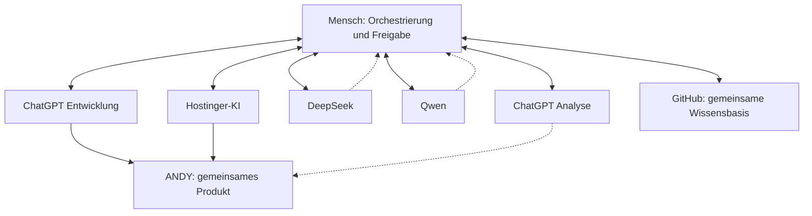

# ANDY Journal – Making of: Story-Katalog und Entwicklungsstand
**25.11.2026 · v0.1 mit Nachtrag MO12 · Redaktioneller Arbeitsbestand, keine Publikationsfreigabe**

## 1. Leitidee
ANDY erforscht Netzwerkdynamik und entsteht selbst durch Netzwerkdynamik. Das Making of dokumentiert Erfolge, Irrtümer, Korrekturen, Arbeitsteilung, Koordination, Kontextverlust und Lernen. Neutralgraue Meta-Ebene mit RGB-Akzenten; weder ausschließlich Research noch Perspectives. Vier Themenbereiche: Co-Creation, Entwicklungsprinzipien, Fehler & Erkenntnisse, Kontinuität & Lernen. Zunächst editierbare Stichpunkte, keine fertigen Essays.

Grundlagen: [Living Lab / Multi-Perspective Development](../../../ANDY_MAKING_OF_LIVING_LAB_MULTI_PERSPECTIVE_DEVELOPMENT_v0.1.md), [Editorial Meta-Prinzip: Der Weg ist das Ziel](../../../ANDY_EDITORIAL_PILOT_META_PRINCIPLE_2026-11-24.md), [WP-ARCH R0.4](../ARCHITECTURE/WP-ARCHITECTURE-R0.4.md), [WP-ARCH R0.5](../ARCHITECTURE/WP-ARCHITECTURE-R0.5.md). Historische Memos bleiben erhalten.

KI-Arbeitsperspektive bezeichnet sichtbare Inputs, Outputs, Rechte, Randbedingungen, Fehler, Korrekturen und überprüfbare Leistungen, keine unterstellte subjektive Erlebniswelt oder Offenlegung internen Reasonings. Menschliche Perspektiven basieren auf geäußerten Entscheidungen und beobachtbaren Rückmeldungen. Effizienz, Qualität, Kreativität und Lock-in sind nicht unabhängig gemessen.

## 2. Technischer Stand und Handoff
| Version | Inkrement | Status |
|---|---|---|
| Making of 0.1.0 | MAKING-OF-PILOT-01: zehn DE/EN-Entwurfspaare, Overview, Detailseite, native WP-Verwaltung | Nutzer: „scheint zu funktionieren“; Home-Reihe zeigte noch alten RGB-Beitrag, keine vollständige Abnahme |
| Making of 0.1.1 | MAKING-OF-HOME-BRIDGE-01: read-only Runtime-Adapter zum vorhandenen Home-Modul | ZIP ausgeliefert; spezifischer Live-Test nicht bestätigt |

Separates temporäres Add-on `andy-journal-making-of`, da der Perspectives-Thread die Composer weiterentwickelt. Basis HC 0.1.37 und CC 0.1.28; Mindestversion CC 0.1.28. Native Standard-Beiträge, gemeinsames Sprachregister, Bilder, Review-Gates, Shared Header/Footer. Kein zweites CMS. Staging-Umgebung wird laut Nutzer eingerichtet, Abschluss und Isolation nicht verifiziert.
- Beiträge → ANDY Making of: expliziter Import von zehn Paaren (20 Entwürfe), keine automatische Veröffentlichung oder Writes bei Aktivierung, bestehende Inhalte schützen, fehlende Partner bei gültiger Registry ergänzen, Konflikte melden. Keine parallelen Registry-Imports.
- Overview separat aktivierbar: /de/making-of/ und /en/making-of/ bei aktivem Language E2E und ohne Pfadkollision; mo_theme-Filter. Noindex/nocache ist kein Zugriffsschutz. Native Standard-Permalinks, Rücklinks; Markierung/Thema bei manueller Übersetzung separat setzen.
- Home 0.1.1: Modul ID making-of, Typ rail verwendet dieselben freigegebenen Story-Daten aus andy_mo_rows() wie Overview. Titel, Beitragsbild, Tags und echte Permalinks; bestehende Gestaltung, Reihenfolge, Limit, Aktivierung erhalten. „Alle Inhalte“ zur sprachgerechten Overview. Nur bei aktiver kollisionsfreier Overview; alter DE-RGB-Eintrag making-of-journal.html als Fallback, wenn ursprünglich ausgewählt und keine nativen DE-Stories öffentlich. Kein erfundener EN-Fallback. Keine gespeicherten Home-Optionen ändern. Andere Module und Composer-ZIPs unangetastet. Kompatibilität mit nächstem Composer-Release testen.
- Rollback durch Deaktivieren der Overview/des Add-ons; native Posts, Edits und Sprachregister bleiben. Spätere Zusammenführung bewusst abstimmen, keine divergierenden Composer-Kopien.

### Artefakte
| ZIP | SHA-256 |
|---|---|
| ANDY-WP-PLUGIN-Journal-Making-of-v0.1.0-MAKING-OF-PILOT-01.zip | 50135fc9c726d7b5153b0f415fec0955d41d435e32794b8afc062ec91c565840 |
| ANDY-WP-PLUGIN-Journal-Making-of-v0.1.1-MAKING-OF-HOME-BRIDGE-01.zip | bc1432d9df5a713451bfd055216c8f534a15e6578ecfb0468bab46c95c8291b0 |
| ANDY-JOURNAL-THREAD-HANDOFF-PERSPECTIVES-v0.1-2026-11-25.zip | a7f8ff08a17ef95430870ddc94e6b5150f83dbf2041aa3b81e631af272c12765 |

Beide Making-of-ZIPs erneut CRC-geprüft, 0.1.1 vier PHP-Dateien und zwei JS-Dateien erneut syntaktisch geprüft, stories.json enthält tatsächlich zehn DE/EN-Paare mit vier Abschnitten je Sprache. Frühere Release-Berichte: 44 isolierte Prüfungen (0.1.0), 54 PHP-/13 JS-Prüfungen (0.1.1), hier nicht erneut ausgeführt. Keine vollständige WP-/Browser-/Mobil-/Datenschutzabnahme. Keine Binärarchivierung.

Perspectives-Handoff enthält Basis-ZIPs, Startprompt, Architekturkontext, Code-Landkarte und Abnahmekriterien. Acht Themen auf Home/Gabelseite/Content integrieren; Content bestimmt Overview bestimmt Home. Bestehenden Code erweitern, insbesondere den auf sechs Vorlagen begrenzten bisherigen Import berücksichtigen. GitHub = langfristige Wissensbasis; Handoff = operativer Auftrag. Der Ausgang des Übergabetests ist nicht bestätigt.

## 3. Vorbereitete Stories MO01–MO10
Die deutschen Stichpunkte aus dem tatsächlich ausgelieferten stories.json (0.1.1) sind hier gesichert; die englischen Fassungen bleiben im ZIP. Kein neues Importpaket, keine Synchronisierung späterer WordPress-Edits. Vier Abschnitte: Episode, menschliche Perspektive, KI-Arbeitsperspektive, Learning/offene Fragen.

### MO01 – Die agile Mona Lisa
**Entwicklungsprinzipien.** Breite vor Perfektion: Warum ein unvollständiges Ganzes mehr zeigen kann als ein perfektes Detail.
- **Episode:** Home, Academy und Perspectives zunächst mit Demo-Inhalten gefüllt. Details bewusst zurückgestellt; Nutzer beurteilt reale Seiten statt bloßer Konzepte.
- **Mensch:** Priorität: ein zusammenhängendes Erlebnis statt isolierter Optimierung. Entscheidet, wann ein Inkrement gut genug ist.
- **KI:** Kleine installierbare Änderungen ermöglichen konkretes Feedback. Beispielinhalt muss als solcher erkennbar bleiben; kein Ersatz für Evidenz.
- **Learning/offen:** Breite kann Architekturprobleme früher sichtbar machen. Offen: welche Iterationsgröße reduziert tatsächliche Nacharbeit?
Quelle: [R0.5](../ARCHITECTURE/WP-ARCHITECTURE-R0.5.md).

### MO02 – Von hinten nach vorne
**Entwicklungsprinzipien.** Eine redaktionelle Änderung sollte nur einmal notwendig sein.
- **Episode:** Academy-Karten und Detailseiten zunächst mit unterschiedlichen Informationsquellen. Content Composer 0.1.26: Nutzer bestätigt redaktionelle Übernahme in die Overview.
- **Mensch:** Erkennt Doppelpflege als langfristiges Problem. Formuliert die Regel: Content bestimmt Overview, Overview bestimmt Home.
- **KI:** Aus konkretem UI-Feedback entsteht ein allgemeines Datenprinzip. Gemeinsame Metadaten statt Kopien; bestehende Original-Demos respektieren.
- **Learning/offen:** Konsistenz ist nicht nur eine Gestaltungsfrage. Offen: dynamischer Perspectives-Home-Crossover und vollständige Prüfung aller Sprachvarianten.
Quelle: [R0.5](../ARCHITECTURE/WP-ARCHITECTURE-R0.5.md).

### MO03 – Der Import, der nichts importierte
**Fehler & Erkenntnisse.** Was ein scheinbar funktionierender Button über die Zusammenarbeit verrät.
- **Episode:** Video-Beispielimport 0.1.25: Nutzer meldet, dass keine Beiträge angelegt werden. 0.1.26: gemeinsamer Importbutton, Statusliste und persistenter Bericht; Nutzer bestätigt Erfolg.
- **Mensch:** Der menschliche Praxistest widerspricht dem isolierten Test. Konkrete Rückmeldung ermöglicht gezielte Korrektur.
- **KI:** Nicht dieselbe Erfolgsmeldung wiederholen: fehlende IDs, Konflikte und Fehler sichtbar machen. Isolierte Tests sind kein Hostinger-Livetest; genaue Ausfallursache bleibt offen.
- **Learning/offen:** Gute Fehlerdiagnostik ist Teil der Benutzeroberfläche. Offen: vollständige WordPress-Regression, Ursachenanalyse des ersten Ausfalls.
Quelle: [R0.5](../ARCHITECTURE/WP-ARCHITECTURE-R0.5.md).

### MO04 – Wenn Vorbilder zu Schablonen werden
**Fehler & Erkenntnisse.** Eine gute visuelle Referenz kann zugleich kreative Vielfalt begrenzen.
- **Episode:** Im Editorial-Pilot ähnelte ein neues Naturmotiv einer vorherigen Referenz in Komposition und Symbolik. Unterschiedliche Motive bedeuten nicht automatisch eigenständige Bildsprache.
- **Mensch:** Der Nutzer erkennt die Ähnlichkeit und macht sie zum Gegenstand der Betrachtung. Originalität und Faktentreue getrennt beurteilen.
- **KI:** Sichtbare Bildausgaben vergleichen statt innere Modellursachen zu behaupten. Referenzwirkung ist eine Hypothese; konvergente Bildkonventionen sind eine Alternative.
- **Learning/offen:** Geplanter Vergleich: Beispielbild, abstrahierte Kriterien, ereignisgetriebene Bildidee. Keine Kausalbehauptung aus einem Einzelbeispiel; interne Pilotdetails erst nach Freigabe.
Quelle: [Editorial Meta-Prinzip](../../../ANDY_EDITORIAL_PILOT_META_PRINCIPLE_2026-11-24.md).

### MO05 – Homogenität in der Vielfalt
**Co-Creation.** Mehrere KI-Perspektiven, ein gemeinsames Entwicklungsziel.
- **Episode:** DeepSeek, Qwen und ChatGPT Analysis entwickeln unterschiedliche Lab-/Dokumentationsvorschläge. Ein weiterer Thread erhält die Aufgabe, einen integrativen Entwurf zu entwickeln.
- **Mensch:** Der Mensch strukturiert Aufgaben, vergleicht Vorschläge und entscheidet über Prioritäten. Unterschiede sollen Erkenntnisse erzeugen, nicht durch Abstimmung verschwinden.
- **KI:** Spezialisierung und Synthese sind unterschiedliche Rollen. Gemeinsame Quellen können gemeinsame blinde Flecken erzeugen; Integrator ist keine Wahrheitsinstanz.
- **Learning/offen:** Dezentrale Ideenentwicklung → Synthese → Prototyp → Kritik. Offen: reduziert diese Arbeitsform tatsächlich Lock-in oder Nacharbeit?
Quelle: [Living-Lab-Memo](../../../ANDY_MAKING_OF_LIVING_LAB_MULTI_PERSPECTIVE_DEVELOPMENT_v0.1.md).

### MO06 – Sudden Death – wenn ein Thread endet
**Kontinuität & Lernen.** Kann ein neuer KI-Akteur die Arbeit übernehmen, ohne den gesamten Chat zu kennen?
- **Episode:** Lange Threads erreichen Kontext- und Längengrenzen. Ein Handoff-Paket für Perspectives enthält Plugin-Basen, GitHub-Referenzen, Aufgabe und Abnahmecheckliste.
- **Mensch:** Die Projektleitung initiiert einen frühen Übergabetest statt auf den Ausfall zu warten. Der neue Thread soll eigenständig auf bestehendem Code weiterarbeiten.
- **KI:** Arbeitsfähigkeit hängt von verfügbaren Artefakten, Kontext und klaren Verträgen ab. Kein verborgenes Gesprächswissen als übertragbar voraussetzen.
- **Learning/offen:** Rolling Handoff: entwickeln, testen, dokumentieren, übergeben. Der Übergabeversuch ist vorbereitet; Ergebnis noch nicht bestätigt.
Quelle: [R0.5](../ARCHITECTURE/WP-ARCHITECTURE-R0.5.md), Handoff (Abschnitt 2).

### MO07 – Gemeinsames Design, eigene Inhalte
**Entwicklungsprinzipien.** Eine Sprachfassung braucht nicht automatisch ein zweites Design.
- **Episode:** DE/EN-Home-Editoren zunächst unterschiedlich; Nutzer bestätigt später die Farbübernahme. Gemeinsame Designwerte, unabhängige redaktionelle Texte und Freigaben.
- **Mensch:** Erkennt unterschiedliche Bedienlogik als Hürde. Will dieselbe Oberfläche mit klarer Trennung von gemeinsamen und sprachabhängigen Einstellungen.
- **KI:** Aus wiederholter UI-Kritik entsteht Shared Design – Localized Content. Nur veröffentlichte bzw. berechtigt sichtbare Sprachpartner verlinken.
- **Learning/offen:** Weniger redundante Einstellungen können Konsistenz unterstützen. Offen: vollständige SEO-, Cache- und Sprachrouting-Abnahme.
Quelle: [R0.5](../ARCHITECTURE/WP-ARCHITECTURE-R0.5.md).

### MO08 – Nicht die Lösung sucht das Problem
**Co-Creation.** Warum Perspectives seinen Ausgangspunkt außerhalb von ANDY nimmt.
- **Episode:** Health-Artikel zu medizinischen KI-Agenten dient als externer Ausgangspunkt. Perspectives wird vor Research im engeren Sinne priorisiert.
- **Mensch:** Der Nutzer fordert bestehende Forschungsfragen statt erfundener Anwendungsprobleme. Er entscheidet, welche Fragen relevant sind.
- **KI:** Externe Primärquelle, ANDY-Beobachtung, mögliche Antwort und Grenzen auseinanderhalten. Ähnlichkeit ist kein Nachweis einer medizinischen oder wirtschaftlichen Wirkung.
- **Learning/offen:** Problem-driven Crossover kann Research-Fragen priorisieren. Offen: fachliche Prüfung und konkrete empirische Antworten.
Quelle: [R0.5](../ARCHITECTURE/WP-ARCHITECTURE-R0.5.md).

### MO09 – Eine Erfolgsmeldung ist noch kein Ergebnis
**Fehler & Erkenntnisse.** Was eine KI liefern muss, damit der Mensch sinnvoll weiterarbeiten kann.
- **Episode:** In R0.4 sind zwei angekündigte E2E-Updates ohne bereitgestellte installierbare ZIPs als Umweg dokumentiert. Die Projektleitung intervenierte; Auslieferung und Prüfstatus wurden als Gate festgehalten.
- **Mensch:** Eine Ankündigung nicht mit einem Ergebnis verwechseln. Ein installierbares Artefakt und konkrete Testmöglichkeiten verlangen.
- **KI:** Explizit trennen: Plan, erzeugte Datei, isolierter Test, Live-Abnahme. Nicht vorhandene Dateien oder Prüfungen niemals als abgeschlossen ausgeben.
- **Learning/offen:** Vertrauen durch überprüfbare Lieferobjekte statt überzeugender Sprache. Offen: durchgängiges Release- und Handoff-Gate in allen Threads.
Quelle: [R0.4](../ARCHITECTURE/WP-ARCHITECTURE-R0.4.md).

### MO10 – Story-driven statt Feature-driven
**Kontinuität & Lernen.** Eine überraschende Beobachtung kann die Entwicklung eines Werkzeugs antreiben.
- **Episode:** Im Living-Lab-Memo ist der Zyklus Ereignis → Frage → Untersuchung → Journal → neue Experimente festgehalten. Die Lab-Funktion folgt dem Erkenntnisbedarf, nicht allein einem Funktionskatalog.
- **Mensch:** Faszination und konkrete Beobachtung geben die Richtung vor. Der Mensch entscheidet, welche Geschichte und welches Werkzeug Priorität haben.
- **KI:** Aus Einzelfällen wiederverwendbare Analyseformen ableiten. Gegenfälle und unklare Befunde dürfen nicht aus der Erzählung verschwinden.
- **Learning/offen:** Erkenntnis und Produktentwicklung können sich gegenseitig verändern. Offen: welche Lab-Templates aus den Fällen dauerhaft nutzbar werden?
Quelle: [Living-Lab-Memo](../../../ANDY_MAKING_OF_LIVING_LAB_MULTI_PERSPECTIVE_DEVELOPMENT_v0.1.md).

## 4. MO11 – Der Mensch als Orchestrator (NEU)
**Co-Creation.** Von der Mensch-KI-Interaktion zum Mensch-KI-Netzwerk.
**Status:** neuer redaktioneller Entwurf aus dem Gespräch vom 25.11.2026, vom Projektleiter als Dokumentationsgegenstand bestätigt. Noch nicht in stories.json/WordPress-Import, keine Publikationsfreigabe.

### Beobachtete Episode
- Bei der Einrichtung der Staging-Umgebung weist die Projektleitung darauf hin, dass sie regelmäßig mit verschiedenen ChatGPT-Threads, DeepSeek, Qwen und der Hostinger-KI gleichzeitig arbeitet.
- Besonders relevant: unterschiedliche Zugriffs- und Handlungsmöglichkeiten. Hostinger-KI führt laut Nutzer serverbezogene Arbeiten direkt bei Hostinger aus; andere Threads entwickeln, analysieren, liefern Artefakte oder prüfen Vorschläge.
- Der Mensch verteilt Aufgaben, überträgt Ergebnisse zwischen Arbeitskontexten, prüft Prototypen und priorisiert. GitHub dient als gemeinsame Referenzbasis. Staging-Aufbau im Gange, keine bestätigte Fertigstellung/Serverprüfung.

### Funktionale Rollen (Arbeitsmodell, keine vollständige Zugriffsmatrix)
| Akteur | Rolle |
|---|---|
| Mensch | Zielsetzung, Priorisierung, Aufgabenverteilung, Auswahl, Integration, Abnahme/Freigabe |
| ChatGPT-Entwicklungsthreads | Konzeption, Code, installierbare Artefakte, Tests |
| ChatGPT-Analyse-Threads | Forschungsfragen, Interpretation, Anforderungen |
| DeepSeek | Ergänzende Perspektiven, Reviews |
| Qwen | Alternative Lösungsansätze und Gegenprüfung |
| Hostinger-KI | Infrastrukturaufgaben mit serverseitigem Handlungsspielraum laut Nutzer |
| GitHub | Externalisiertes Projektwissen, Versionierung, Referenzbasis; kein KI-Akteur |

Vereinfachte Skizze; keine Behauptung direkter KI-zu-KI-Kommunikation oder identischer Rechte. Verschiedene ChatGPT-Threads sind unterschiedliche Arbeitskontexte, nicht zwingend unterschiedliche Modelle.

### Menschliche Perspektive
- Nicht nur mit einer KI arbeiten, sondern ein heterogenes Netzwerk koordinieren. Nicht alle Akteure benötigen dasselbe Wissen oder dieselben Rechte.
- Der Mensch organisiert Handlungsmöglichkeiten, integriert Teilergebnisse, entscheidet bei Konflikten und verantwortet Freigaben.
- Staging als geschützter Integrationsraum ist ein Ziel der Einrichtung; tatsächliche Isolation und Zugriffsschutz prüfen.

### KI-Arbeitsperspektive
- Kein einzelner Thread muss den gesamten Projektkontext besitzen. Kohärente Teilergebnisse benötigen jedoch klare Zuständigkeiten, Schnittstellen, aktuelle Artefakte und Referenzen.
- Lokale Output-Qualität bedeutet nicht automatisch globale Kompatibilität. Spezialisierung erlaubt parallele Arbeit, erzeugt aber mögliche Konflikte, Kontextverlust und Nacharbeit. Zugriff und Kompetenz nicht gleichsetzen.
- KI-Review ist kein Beweis; abweichende Vorschläge und menschliche Prüfentscheidungen erhalten. Keine Zuschreibung verborgener Absichten oder autonomer Gesamtorchestrierung.

### Learning & offene Fragen
- Anschluss an MO05 (Vielfalt/Synthese), MO06 (Kontinuität), MO09 (überprüfbare Ergebnisse) und [Nested Competitive Networks](../../../../research/andy-lab/CORE/v0.1/03_NESTED_COMPETITIVE_NETWORKS.md). Hier überwiegend kooperativ; Konkurrenzkonzept nicht unbesehen übertragen.
- Möglicher Selbstversuch: Einzel-KI-Arbeit vs. arbeitsteilige Zusammenarbeit. Dafür Aufgaben, Rollen, Kontextstände, Übergaben, Varianten, Korrekturen, menschliche Entscheidungen und tatsächlichen Aufwand dokumentieren. Keine unkontrollierte Produktivitätsbehauptung.
- Wann übersteigt Koordination den Nutzen der Spezialisierung? Wie wirken unterschiedliche Rechte und Gegenprüfungen? Wie Handlungsfähigkeit bei Ausfall eines Arbeitskontexts erhalten?
- Leitthese als Perspektive: **Wir entwickeln nicht nur ANDY. Wir entwickeln zugleich eine Organisationsform für die Zusammenarbeit von Menschen und künstlichen Intelligenzen.**

## 5. Weiterführung
MO11 später als Importinkrement ergänzen, vorhandene redaktionelle Edits erhalten. Konkrete Episoden sammeln und erst später ausformulieren. Quellen/Datum, Rollen, sichtbare Ergebnisse, Fehler, Korrektur, Abnahmestatus festhalten. Keine privaten Rohdialoge, internen Matchdaten oder vertraulichen Infrastrukturinformationen veröffentlichen. Kein neues Plugin und keine Änderung an WordPress durch diesen Commit.

## 6. MO12 – Vom Werkzeug-Wildwuchs zur Betriebszentrale (25.11.2026)

**Entwicklungsprinzipien · Fehler & Erkenntnisse · Kontinuität & Lernen.** Warum funktionierende Komponenten noch keine verständliche, sichere Betriebsarchitektur ergeben.

**Status:** Von der Projektleitung als Weichenstellung ausdrücklich bestätigt und zur GitHub-Dokumentation beauftragt. **Redaktioneller Story-Entwurf, noch nicht in `stories.json` oder WordPress importiert; keine Publikationsfreigabe und kein nachgewiesener Performancegewinn.** Verbindlicher technischer Beschluss: [PRE-STAGING-01 – Admin- und Launch-Governance](../ARCHITECTURE/ANDY-JOURNAL-PRE-STAGING-ADMIN-UND-LAUNCH-GOVERNANCE-2026-11-25.md).

### Beobachtete Episode
- Nach vielen kurzen Entwicklungsiterationen zeigt WordPress am 25.11.2026 **20 Plugin-Einträge (18 aktiv, 2 inaktiv)**, zugleich mehrere Verwaltungswege: **ANDY Journal**, **Beiträge** und **Werkzeuge**. Eine Werkzeugzentrale verweist auf bereits vorhandene Funktionen; ihr Kachelbestand stellt nicht zusätzliche Plugins dar.
- Zwei technisch verschiedene Funktionen tragen nahezu denselben Namen **ANDY Content Manager**. Neben einem aktiven Content Composer 0.1.29 erscheint eine alte inaktive Version 0.1.4; der Home Composer wird in der Pluginliste als 0.1.38, in einem Admin-Screenshot als 0.1.37 gezeigt. Das sind **Prüfpunkte**, noch keine Hinweise auf defekte Laufzeit.
- Die Projektleitung fragt nach Redundanz und Verständlichkeit und bestätigt eine neue Governance: **ein Cockpit als Betriebszentrale**, die existierende Fachfunktionen verlinkt statt sie erneut zu bauen. Zuvor hatte sie die Trennung von Live, Staging und Coming Soon über alle drei Contentebenen gefordert.
- Die Umstellung auf `journal.andy-arena.com` wird vom Nutzer als im Backend, Editing und Frontend funktionsfähig gemeldet. Eine getrennte Staging-Instanz ist erst geplant und **nicht nachweislich eingerichtet**.

### Menschliche Perspektive
- Der Mensch erkennt, wann das schnelle Ergänzen einzelner Werkzeuge zu administrativer Unübersichtlichkeit führt und eine **Strukturentscheidung** wichtiger wird als das nächste Feature.
- Die bewusste Entscheidung ist **nicht** „Plugins reduzieren um jeden Preis“, sondern Verantwortung, Freigaberechte und Navigationswege zu ordnen. Bewährte Mechaniken sollen erhalten bleiben.
- Die Idee einer gemeinsamen Home für Live/Staging mit DE/EN-Coming-Soon-Inhalten schützt die gewachsene visuelle Identität; das Veröffentlichungsgedächtnis schützt bereits einmal publizierte Inhalte vor Verwechslung mit neuen Entwürfen.
- Der Mensch setzt eine Reihenfolge: erst Inventur und klonfähiger Ausgangsstand, dann Staging-Kopie, anschließend sichere experimentelle Bereinigung.

### KI-Arbeitsperspektive
- Die Aufgabe verschiebt sich von **Featureproduktion** zur **Schnittstellen-, Zuständigkeits- und Governanceanalyse**. Namen, Menüs, Module und eigenständige Pluginordner sind getrennte Einheiten; sichtbare Dopplungen beweisen nicht doppelte Datenhaltung oder Frontendlast.
- Eine bereits implementierte Cockpit-0.2.0-Option zur reversiblen Menübereinigung muss zuerst geprüft werden; sie neu zu implementieren wäre das Gegenteil von Kontinuität. Ausblenden eines Menüs, Deaktivieren von Code und Löschen von Daten sind unterschiedliche Handlungen.
- Eine tragfähige Antwort unterscheidet **Architekturbeschluss**, **historische Dokumentation**, **lokale Tests** und **reale WordPress-Abnahme**. Die installierten Versionen, Codepfade, Hooks und Abhängigkeiten müssen vor schreibenden Eingriffen geprüft werden.
- Kein KI-Akteur sollte aus der Pluginanzahl ungeprüfte Performancebefunde ableiten oder sich anmaßen, überflüssige Komponenten ohne Nutzungsaudit zu entfernen.

### Learning & offene Fragen
- **Entwicklungsparadox:** Modulare Arbeitsteilung ermöglicht Geschwindigkeit, erzeugt jedoch mit wachsender Zahl von Schnittstellen **Koordinationskosten und Benennungsdrift**. Die Lösung besteht nicht zwingend in weniger Modulen, sondern in **einem erkennbaren Einstieg und klaren Ownership-Grenzen**.
- **Konsistenz durch Datenfluss:** Content → Gabelseite → Home soll auf einer gemeinsamen Quelle beruhen. Launch-Freigaben ergänzen diesen Datenfluss, ohne `post_status` zu überschreiben. Neue Entwürfe werden beim Bereichsstart nicht automatisch öffentlich; bewusst zurückgezogene Beiträge bleiben zurückgezogen.
- **Reversibilität als Qualitätskriterium:** Einstellungen, Direktlinks, Legacy-RGB-Routen, Editor-Daten und Rückwege sind Teil des Produkts, nicht bloßer Implementierungsballast.
- **Offene Evidenz:** Verbessert die Cockpit-Harmonisierung die Fehlerquote bzw. die Zeit zur Bedienung? Was zeigen Messungen zu Query-/Asset-/Cache-Last tatsächlich? Wie verhält sich Publication Control bei REST, Sitemaps, Feed, Sprachpartnern und Cache? Keine Wirkung vor entsprechenden Messungen behaupten.
- **Anschluss an frühere Stories:** MO02 (Content als Quelle), MO06 (Rolling Handoff), MO09 (Test ≠ Resultat), MO11 (Mensch als Orchestrator). Dass die Perspectives-Weiterentwicklung nach Thread-Wechsel lokal installierbare Updates hervorgebracht hat, ist ein beobachtbares Continuity-Teilergebnis; die vollständige Live-Abnahme bleibt separat.

### Technischer Nachtrag PRE-STAGING-01A · Quellprüfung abgeschlossen

Die am 25.11.2026 aus WordPress exportierten Pluginverzeichnisse ermöglichen erstmals, die beschriebene Navigations-Unübersicht **gegen den tatsächlich installierten Code** zu prüfen: Im aktiven ANDY-Stand sind **22 Admin-Menü-Registrierungen** erkennbar, während das Cockpit 0.2.0 bereits einen **reversiblen Kompaktmodus** besitzt, der neun redundante Werkzeuge-Links ausblenden kann. Zwei gleichnamige „ANDY Content Manager“ gehören nachweislich zu **unterschiedlichen Funktionen**. Damit korrigiert der technische Nachweis eine mögliche vorschnelle Erzählung von „doppelter Software“: Die eigentliche Redundanz liegt zuerst in **Auffindbarkeit, Benennung und Ownership**, nicht automatisch in Programmlogik oder Performance.

Die Quellprüfung deckte zugleich einen **neuen Koordinationsfehler an der Umgebungsgrenze** auf: Cockpit, Launch Control, RGB Pilot und Home Composer enthalten feste Host-Abhängigkeiten zu `journal.andy-arena.com`; auf der geplanten anderen Staging-Domain wären ohne Anpassung gerade jene Werkzeuge und Home-Funktionen nicht gleich verfügbar, deren Identität Ziel der Trennung ist. Diese Erkenntnis veranschaulicht MO11/MO12: Ein Lokaloptimierungs- und Schutzentscheid aus einer früheren Testphase kann später zum Integrationshindernis werden. **Noch kein Live-Versagen oder messbarer Performanceeffekt nachgewiesen**, sondern ein konkret belegter statischer Blocker, für den ein sicherer Umgebungsvertrag erarbeitet werden soll.

Quellnachweis: [PRE-STAGING-01A-Audit](../ARCHITECTURE/ANDY-JOURNAL-PRE-STAGING-01A-PLUGIN-MENUE-HOOK-AUDIT-2026-11-25.md), Archiv-SHA-256 `4277fcb18aa60d55b3e7e940d23143088b402addf7344abf8432610ed0fe420a`. Kein WP-/Plugin-Update oder Publikationsereignis durch diesen Nachtrag.

### Entwicklungsnachtrag PRE-STAGING-01B · Von der Architekturentscheidung zum überprüfbaren Release

Am 25.11.2026 wurde die in MO12 formulierte Governance erstmals in **konkreten Plugin-Code** übersetzt, und zwar aus dem tatsächlich exportierten WordPress-Quellstand: **Journal Cockpit 0.2.1**, **RGB Pilot 0.6.4** und **Home Composer 0.1.39**, jeweils mit Original-Rollback-ZIP. Das Cockpit verlinkt nun 21 bestehende Werkzeuge in fünf Gruppen, statt neue Fach-Engines zu schaffen. Die ursprünglich voneinander unabhängigen Host-Checks wurden für Production und die **ausdrücklich gekennzeichnete** spätere Staging-Umgebung harmonisiert. Die Admin-Berechtigung bleibt bestehen; Staging-Vorschau für Nicht-Administratoren erfordert nachweislich eingerichteten externen Zugriffsschutz. Ein alleiniger `noindex`-Header reicht nicht.

**Beobachtbares Teilergebnis:** 103 isolierte, lokale Prüfungen bestanden; die vorhandenen Home-/RGB-Routingfunktionen und eingebetteten Assets wurden nicht umgebaut. **Nicht behaupten:** eine bereits erfolgte Hostinger-Installation, Staging-Isolation oder Produktivfreigabe. Der Schritt illustriert, dass eine gute Mensch-KI-Kollaboration nicht mit dem Verfassen eines Beschlusses endet: Sie liefert überprüfbare, umkehrbare Artefakte und benennt die weiterhin offenen Integrationsbedingungen. [Release-/Abnahmeprotokoll](../ARCHITECTURE/ANDY-JOURNAL-PRE-STAGING-01B-UMGEBUNGEN-UND-COCKPIT-RELEASE-2026-11-25.md).

**Leitsatz für das spätere Making of:** **Nicht die Anzahl der Werkzeuge entscheidet, sondern ob ihre Zusammenarbeit verständlich, überprüfbar und umkehrbar bleibt.**

**Redaktionelle Folge:** MO12 als neuen Backlog-Eintrag vormerken, später mit Original-Screenshots, tatsächlicher Cockpit-Vorher/Nachher-Abnahme und Versionsregister ausformulieren. Keine WordPress-Importänderung oder Veröffentlichung aus diesem GitHub-Kommentar.
