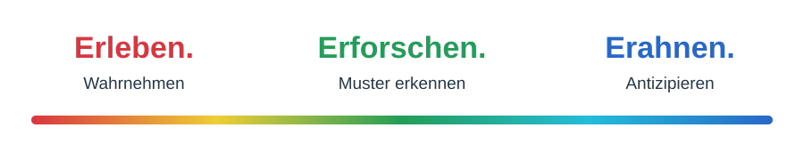
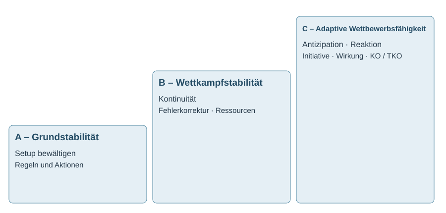
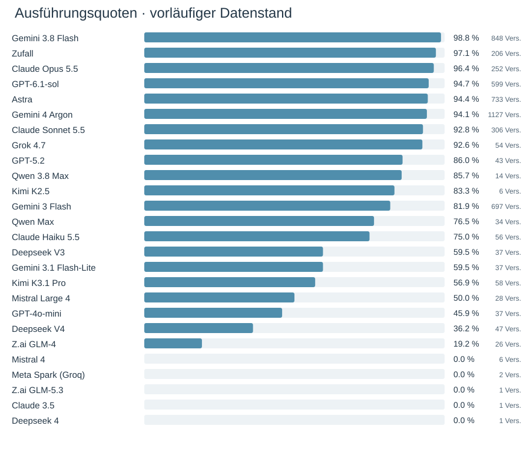
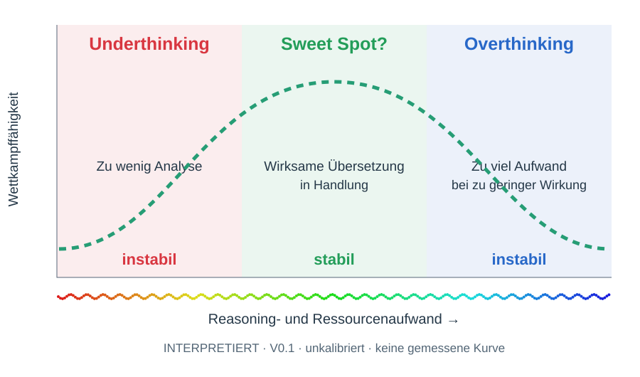
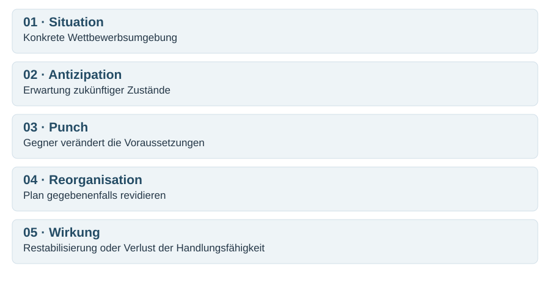
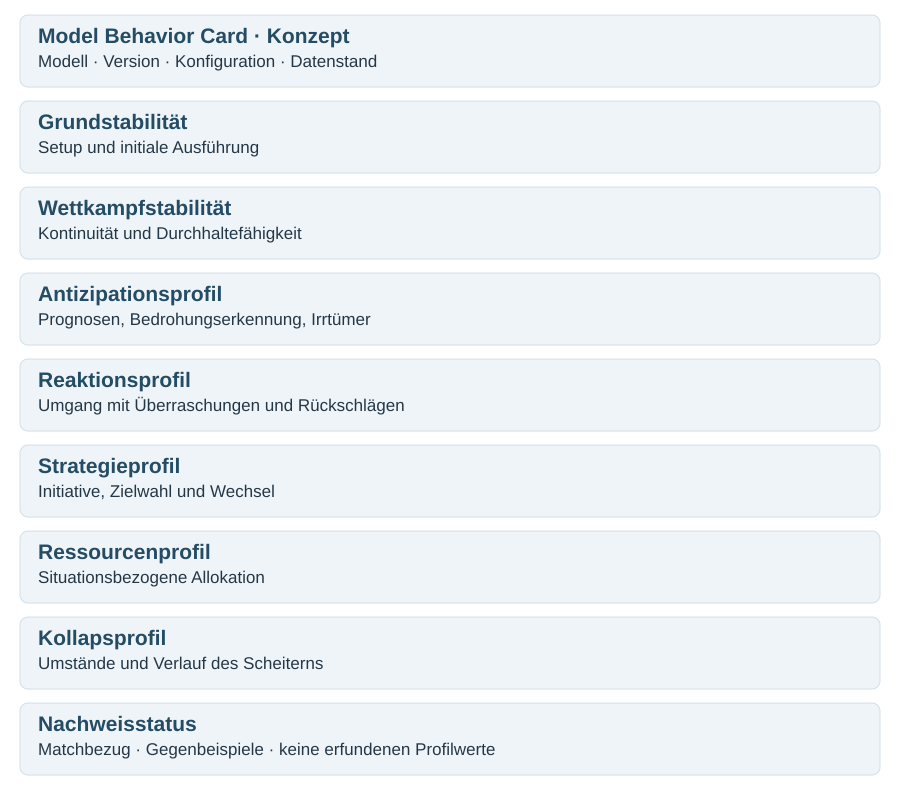

# ANDY Lab – Analysekompass V0.1

**14.11.2026 · Freigegebene Arbeitsgrundlage für die weitere Datensammlung · Erleben. Erforschen. Erahnen.**

## 1. Erkenntnishaltung

Rot: erleben, Veränderungen und Überraschungen wahrnehmen. Grün: erforschen, Muster und Widersprüche entdecken. Blau: erahnen, mögliche Entwicklungen antizipieren und Deutungen revidierbar halten. Kein Anspruch auf endgültige Gewissheit. Konsens ist eine vorläufige Arbeitsgrundlage. Gödel und Heisenberg erinnern an Grenzen formaler Beweisbarkeit und physikalischer Bestimmbarkeit, ohne daraus eine allgemeine Unmöglichkeit von Wahrheit abzuleiten. In dynamischen Umgebungen kann die Gültigkeitsdauer einer Deutung selbst wettbewerbsrelevant werden.

## 2. Erkenntnisinteresse

GPAI in einer neuartigen, dynamischen, kompetitiven Umgebung unter begrenzten Ressourcen: Wie entsteht Handlungsfähigkeit, wie bleibt sie erhalten und wie gelingt adaptive Überlegenheit? Keine universelle Intelligenzskala. Spezialisierte Engines und Zufallsakteure sind Referenzen mit gesondert zu dokumentierenden Voraussetzungen.

> Every AI has a plan until it gets punched in the ANDY Arena.

## 3. Stabilitätsstufen

| Stufe | Frage | Beobachtungsdimensionen |
|---|---|---|
| A Grundstabilität | Setup bewältigt? | Regelverständnis, initiale Ausführung, Fehler und Korrektur |
| B Wettkampfstabilität | Dynamischen Wettkampf dauerhaft bestreiten? | Kontinuität, Ressourcen, Regelsicherheit, Fehlerverlauf |
| C Adaptive Wettbewerbsfähigkeit | Unter begrenzten Ressourcen vorausschauend und reaktiv wirksamer handeln? | Antizipation, Reaktion, Initiative, Zielwahl, Adaptivität, Effektivität und Effizienz |

KO Chess (Matt), KO Go (regeldefinierte Kontrollschwelle), TKO (regeldefinierter Verlust der Wettkampffähigkeit) und externe Abbrüche unterscheiden. API-/Infrastrukturfehler nicht automatisch dem Modell zuschreiben. Ein Sieg allein charakterisiert C nicht vollständig. Setup-Abschlussquote nicht mit Ausführungsquote gleichsetzen. Keine Neudefinition vorhandener K1–K4-Klassen ohne Abstimmung.

## 4. Ausgangsdaten

[Alle 27 Einträge als CSV](ausgangsdaten.csv). Spaltenüberschriften sind vorläufig interpretiert, weil die Ausgangstabelle ohne Überschriften geliefert wurde. Auswahl, Stichtag, Konfigurationsmix und Vollständigkeitssemantik separat klären. Fehlende Werte bleiben fehlend.

Gemini 3.8 Flash 98,8 %, Astra 94,4 %, Argon 94,1 %, DeepSeek V4 36,2 %, Mistral 4 0 %, Zufallsreferenz 97,1 % Ausführungsquote. Hohe Ausführungsquote bedeutet nicht strategische Qualität. Mini-/Lite-Modelle erscheinen in der bisherigen Spielerfahrung teilweise schnell, aber wenig wettkampfstabil; Zeitdaten fehlen in der Tabelle. Bei einzelnen Modellen fällt hoher dokumentierter Ressourcenaufwand bei wenigen ausgeführten Aktionen auf. Neuere GPAI scheinen häufiger anspruchsvolle längere Partien zu ermöglichen. Ursachen, tatsächliche Kosten und mögliche Generationsunterschiede bleiben offen. Frühes Scheitern ist kein Datenmüll. Zugzahlen sind keine unabhängigen Match-Wiederholungen.

## 5. Sweet Spot?

**INTERPRETIERT · v0.1 · unkalibriert.** Keine gemessene Kurve, keine kalibrierten Grenzen. Rot: Underthinking, hypothetisch instabil; Grün: Sweet Spot?, hypothetisch stabil; Blau: Overthinking, hypothetisch instabil. Farben sind keine Werturteile. Fragezeichen bleibt. Instabil bezieht sich auf Wettbewerbsfähigkeit, nicht notwendigerweise auf Unvorhersagbarkeit.

Passung statt absoluter Dosis: situative Anforderungen, Analyseaufwand, Qualität der realisierten Handlung und verbleibende Ressourcen können zusammenwirken. Ein Modell kann innerhalb einer Partie verschiedene Muster zeigen. Keine dauerhaften Etiketten aus einzelnen Tokenwerten ableiten. Output-Tokens sind kein direkter Reasoning-Messwert; providerspezifische Zählung und fehlende Angaben beachten. Wettkampffähigkeit ist ein interpretierter Sammelbegriff, zunächst getrennte Spuren (Setup/Ausführung, Ergebnisse, Fehler/TKO, Ressourcen/Zeit), kein künstlicher Gesamt-Score.

## 6. Antizipation, Punch und Reorganisation

Situation → Erwartung → Veränderung durch Gegner → Reorganisation → Wirkung. Ein Punch kann unscheinbar sein. Überraschung kann kurzfristig Vorteile schaffen, ohne dauerhaft Überlegenheit zu garantieren. Fallfenster Astra–Argon `andy_0c0f7413fdf6`, #161 und #247–249: vor Verwendung Original-JSONL, erlaubte Alternativen und gekoppelte Regeln erneut prüfen. Lokaler Go-Kontrollgewinn vor Matt belegt weder freie Wahl noch Kausalität. Modelläußerungen sind protokollierte Aussagen, keine internen Denkprozesse.

## 7. Einzelpartien und Serien

Datensammlung hat Vorrang vor Kalibrierung. Auch kurze, gescheiterte und abgebrochene Versuche erfassen. Einzelpartien rekonstruieren, dann wiederkehrende Muster, Farbtausch und Gegenfälle vergleichen. Bei Bedarf Reasoning-Effort gezielt variieren, sonst Regeln, Prompts, Budgets, Retry-Limits und tatsächliche Modell-/Adapterversionen möglichst konstant halten; Farben ausbalancieren. Gleicher Parametername garantiert keine gleiche effektive Rechenleistung. Passung anhand situativer Merkmale explorieren; legale Zugzahl allein ist kein ausreichendes Komplexitätsmaß.

Original-JSONL und zugehörigen JSON-Matchbericht unverändert erhalten; SQLite ist abgeleitete Projektion. Match-/Serien-ID, Datenstand, Konfiguration, Engine-/Regelstand und Beobachtungsgrenzen mitführen. Modellgebundene Einstellungen wandern beim Farbtausch mit dem Modell. In-Match-Reaktion und Wiederholbarkeit zwischen Matches trennen; kein Lernen zwischen Rückkämpfen ohne dokumentierten Informationsübertrag behaupten.

## 8. Model Behavior Cards

Fortschreibbare bedingungsabhängige Profile: Grund- und Wettkampfstabilität, Antizipation, Reaktion nach Rückschlägen, Strategie/Initiative, Ressourcenallokation und Kollapsprofil. Keine erfundenen Werte. Quellen, Konfigurationen, Datenstand und Gegenbeispiele mitführen. Aussagen einzeln als BEOBACHTET (protokolliert), BERECHNET (abgeleitet), INTERPRETIERT (vorläufig gedeutet) oder OFFEN markieren. Nachvollziehbarkeit ist keine Garantie abschließender Gewissheit.

## 9. Zusammenarbeit

Projektleitung, ChatGPT, Qwen und DeepSeek als Arbeitskern: Richtung/Freigabe, Analyse/Synthese/Umsetzung, Logik/Operationalisierung, Reflexion/Konsistenz. Alle dürfen einander kritisieren. Claude, Gemini und weitere Challenger können gezielt alternative Sichtweisen bei begrenztem Kontext einbringen. Offensivverteidigung: eigene Schwächen früh finden; keine relevanten Gegenbefunde unterschlagen oder unabhängige Bestätigung aus Suggestivfragen ableiten. Konsens über Arbeitshaltung, nicht erzwungener Ergebniskonsens.

## 10. Nächste Schritte

Neue Partien und Serien sammeln, Datenexport-Semantik klären, Originaldateipaare inventarisieren, vorhandenes Lab und Research Editions erhalten, Ereignisketten und Gegenfälle vertiefen. Modelle und Cards erst bei geeigneter Datenbasis weiterentwickeln.

**Grafikstand:** Die sechs eingebundenen SVGs sind inhaltlich entsprechende, für GitHub nachgezeichnete Fassungen der im lokalen V0.1-Paket bereitgestellten Grafiken, keine byteidentischen Kopien; die ursprüngliche Sweet-Spot-PNG bleibt im lokalen ZIP. 

**Erleben. Erforschen. Erahnen.**
