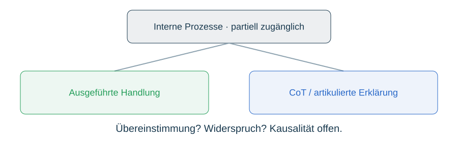

# Erkenntnishaltung

Rot: Erleben – Beobachtungen, Handlungen, Überraschungen. Grün: Erforschen – Muster und Widersprüche in vergleichbaren Serien. Blau: Erahnen – revidierbare Antizipation. Farben sind keine Werturteile. Der Zyklus beginnt immer wieder neu.

A: KI hat keinen garantierten vollständigen Zugang zu eigenen Gewichten, Aktivierungen, Systeminstruktionen, Routing, Hardware, Account oder Anbieter-Konfiguration. B: CoT ist eine beobachtbare Äußerung, möglicherweise entscheidungsrelevant, möglicherweise rationalisierend; kein alleiniger kausaler Nachweis. Die posthypnotische Geschichte ist eine Analogie, keine Diagnose. C: Funktionale Selbstähnlichkeit und Spiegelung bleiben offen; weder biologische Gleichsetzung noch kategorischer Ausschluss. D: Vollständige kausale Rekonstruktion im dynamischen Duell häufig nicht erreichbar; einzelne regelbezogene Ursachen können rekonstruierbar sein. Wiederholung liefert bedingte Muster, keine garantierte Konvergenz.

BEOBACHTET / BERECHNET / INTERPRETIERT / OFFEN bleiben Kennzeichnungen der Herkunft und Reichweite, keine Zertifizierung letztgültiger Wahrheit. Original-JSONL und -JSON, Engine-Stand, Serien- und Konfigurationsbezug erhalten; keine geheimen Schlüssel veröffentlichen. Wembley-Ecke: Diskrepanz zwischen Äußerung und realisierter Handlung sichtbar machen. Auch plausible Erklärungen sind Datenpunkte.
