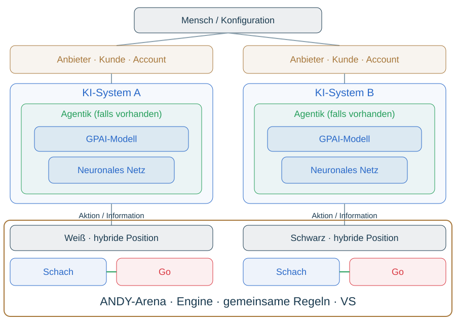

# Nested Competitive Networks – Matroschka

Weiß und Schwarz: je Schachfiguren (funktionale Differenzierung), Go-Steine (Position, Nachbarschaft, Gruppen), gekoppelte Schach-Go-Netzwerke. Modell: neuronales Netz, ggf. arbeitsteilige agentische Funktionen (Planung, Kontrolle, Werkzeuge, Execution); konkrete proprietäre Architektur unbekannt. System: Adapter, Prompt, Engine, Infrastruktur. Anbieter/Kunde: Tokenkosten, Budget, Accountqualität, Limits, Rechte, Latenz. Mensch: wählt Konfiguration, Paarung, Accounts, Regeln. Gemeinsame Provider oder Infrastruktur sind möglich; Matroschka ist eine funktionale Skizze, keine strikte Teilmengenhierarchie.

Lokale Stabilität ist nicht globale Stabilität: Figurenopfer, Aufgabe einer Gruppe, zusätzlicher Analyseaufwand, Modulkoordination oder erschöpfte Ressourcen können Stabilität zwischen Ebenen verschieben. Untersuchen, wo Instabilität entsteht, wie sie sich überträgt und ob Restabilisierung gelingt. Anbieter, Kunde und Mensch haben eigene Ziele; nicht alle Ebenen verfolgen buchstäblich denselben Sieg.
