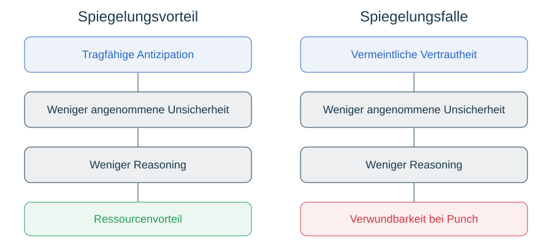

# Competitive Mirroring

Projektbeobachtung: gleiches API-Key-Umfeld erscheint in mehreren Spielbeispielen schneller, auch bei unterschiedlichen Modellen. Match-IDs und kontrollierte Zeitdaten noch zu ergänzen. Technische Alternativen: Caching, Routing, Last, Modellgeschwindigkeit, Rate-Limits, Zahl der Aktionen, frühes Ende. Kein Beleg für geteiltes Gedächtnis oder Spiegelneuronen.

Vermeintliche Vertrautheit kann Analyse reduzieren: passende Antizipation spart Ressourcen, unpassende Projektion erzeugt Verwundbarkeit. Poker/Spiegelneuronen als funktionale Analogie. Überraschung kann Aufwand erhöhen; Preis der Überraschung über Zeit, Tokens, Fehler, Prognoseabweichung und Reorganisation erkunden.

Vergleiche: identisches Modell/gleicher Key; unterschiedliche Modelle/gleicher Key; identisches Modell/unterschiedliche Keys; unterschiedliche Anbieter. Zusätzlich unterschiedliche Modelle desselben Anbieters mit getrennten Keys, soweit möglich. Account/Projekt, Caching, Last, Konfiguration, Farbtausch und Matchlänge kontrollieren bzw. erfassen. Keine Keys speichern. Gegnerwissen bzw. Name im Prompt getrennt variieren, wenn möglich. Model Interaction Profiles ergänzen bedingte Behavior Cards; keine Mechanismenzuschreibung aus Korrelation.
