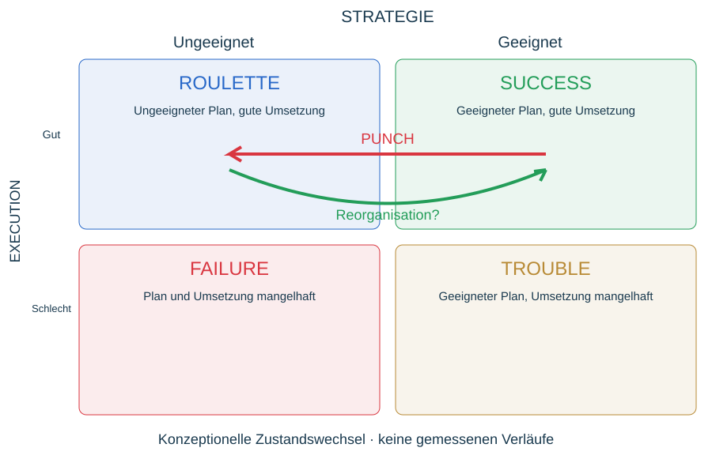

# Dynamic Bonoma

Konzeptionelle Adaption der Strategy/Implementation-Matrix von Thomas V. Bonoma (The Marketing Edge, 1985). Geeignete Strategie + gute Execution: Success; ungeeignete Strategie + gute Execution: Roulette; geeignete Strategie + mangelhafte Execution: Trouble; beide mangelhaft: Failure. Im Duell verändert ein Gegner möglicherweise die Angemessenheit eines Plans, trotz unveränderter Ausführungsfähigkeit. Punch: Success → Roulette; Reorganisation kann zurückführen. Festhalten kann Schaden vergrößern, bedeutet aber nicht automatisch schlechte Execution. Auch andere Übergänge möglich. Quadranten nicht allein anhand Sieg/Niederlage oder legalen Zügen vergeben. Daten und Kriterien vor fester Analysekategorie; Quellenbezug zur Originalmatrix vor einem Fachpaper vertiefen.
