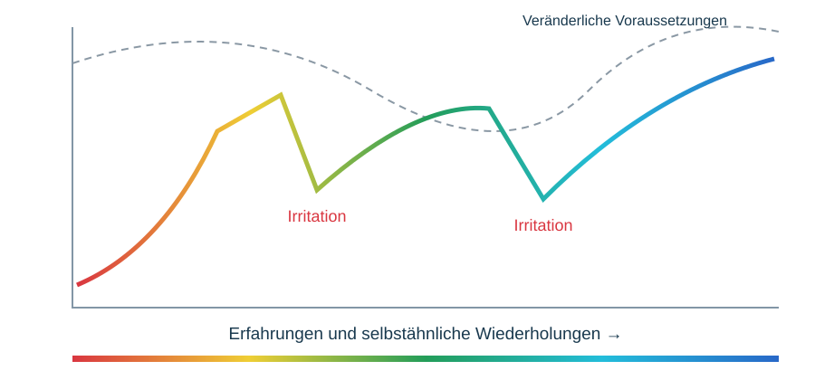

# Adaptive Erkenntnisannäherung

Selbstähnliche Wiederholung verdichtet Muster unter vergleichbaren Bedingungen. Neue Gegner, Modelle, Konfigurationen oder Gegenbeispiele können Erkenntnisse destabilisieren. Die Annäherung ist nicht monoton und hat keine garantierte unveränderliche Zielkurve. Auch unser Lab ist ein adaptives Erkenntnissystem. Die Grafik ist rein konzeptionell.

Serien mit Farbtausch, dokumentierten Versionen, Regeln, Budgets und Ressourcen; Modellkonfiguration wandert mit Modell. Einzelereignisse, Serien und Konfigurationsgruppen unterscheiden. Fehlgeschlagene Setups und externe Abbrüche berücksichtigen. Keine unabhängigen Wiederholungen aus vielen Zügen einer Partie fingieren. Keine Lernbehauptung zwischen Matches ohne Informationsübertrag. Cards: Setup, Kontinuität, Antizipation, Reaktion, Strategie, Ressourcen, Kollapsprofil, Interaktionsabhängigkeit, Gegenfälle und Herkunft. Daten sammeln, Muster erkunden, Interpretation revidieren.
