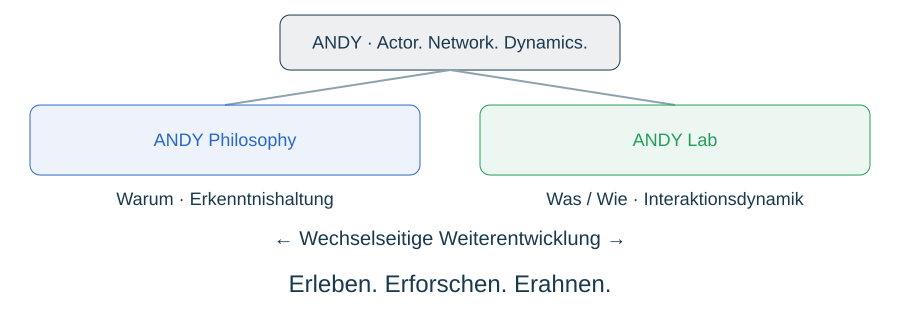
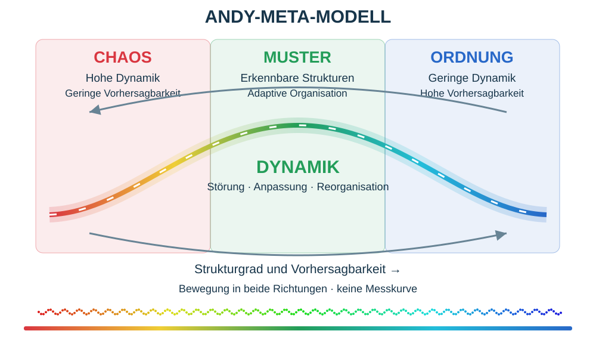
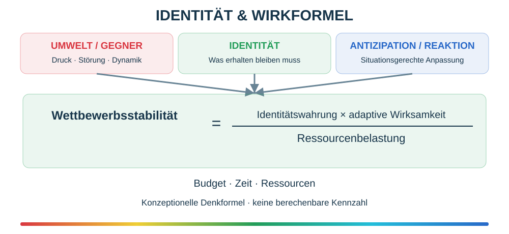
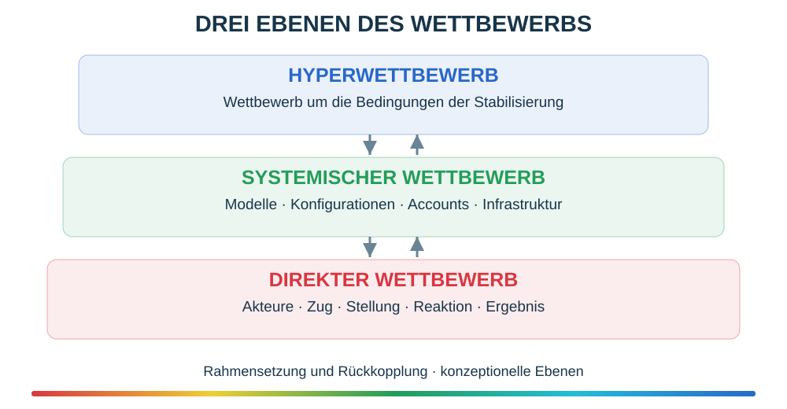
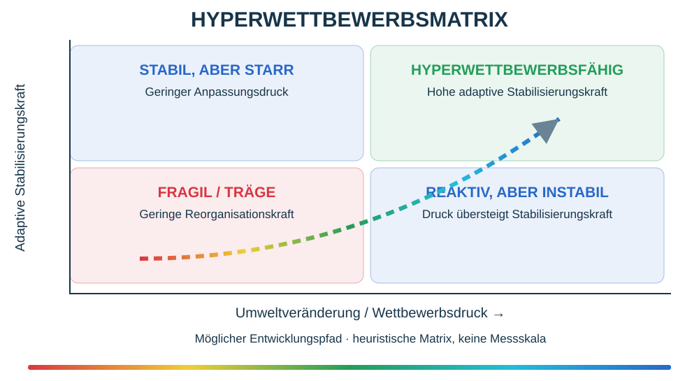

# ANDY Philosophy

Actor. Network. Dynamics. Die Philosophie beschreibt das Warum und die Erkenntnishaltung; das Lab erkundet das Was und Wie. Menschliche Gestaltung bleibt wesentlich. Erkenntnis als adaptive Stabilisierung: Erleben, Erforschen, Erahnen.

Gödel: Grenzen formaler Beweisbarkeit in hinreichend mächtigen konsistenten effektiv axiomatisierten Systemen; kein mathematischer Nachweis der KI-Blackbox. Heisenberg: Unschärfe bestimmter physikalischer Größen; Preis zusätzlicher Abfragen/Reasoning als funktionale Analogie, nicht Quantenmechanik. Douglas Hofstadter, Gödel, Escher, Bach (1979): Selbstreferenz, verschachtelte Hierarchien, seltsame Schleifen. Fritjof Capra, The Tao of Physics (1975): philosophischer Denkrahmen zu Relationalität und Dynamik. Keine physikalische Gleichsetzung von Schach und Go, keine allgemeine Widerlegung von Kausalität. Denkanstöße und Legitimation der Offenheit, keine formale Ableitung von KI-Eigenschaften.

## ANDY-Meta-Modell – Erweiterung der konzeptionellen Basis

Persönliche Weltsicht der Projektleitung als eigenständiger Denkrahmen: Chaos (rot, hohe Dynamik, niedrige Vorhersagbarkeit), Muster (grün), Ordnung (blau, geringe Dynamik, hohe Vorhersagbarkeit). Dynamik ist wesentlich: Störung, Anpassung und Reorganisation können in beide Richtungen führen. Die Kurve ist symbolisch, nicht gemessen. Ordnung allein garantiert keine adaptive Stabilität. Die vier philosophischen Referenzen werden aus dieser offenen Perspektive eingeordnet.

Wettbewerbsstabilität = Identitätswahrung × adaptive Wirksamkeit / Ressourcenbelastung. Konzeptionelle, im Dialog freigegebene Denkformel, keine numerische Kennzahl.

Direkter Wettbewerb, systemischer Wettbewerb und Hyperwettbewerb als gekoppelte Betrachtungsebenen; Rahmensetzung und Rückkopplung wirken in beide Richtungen.

Heuristische Matrix aus adaptiver Stabilisierungskraft und Umweltveränderung/Wettbewerbsdruck. Die Quadranten und der mögliche Entwicklungspfad sind konzeptionelle Entwürfe, keine feststehenden Klassifikationen. Die vier SVGs sind Neuzeichnungen der freigegebenen visuellen Entwürfe; keine behauptete Originalreproduktion früherer Darstellungen.
