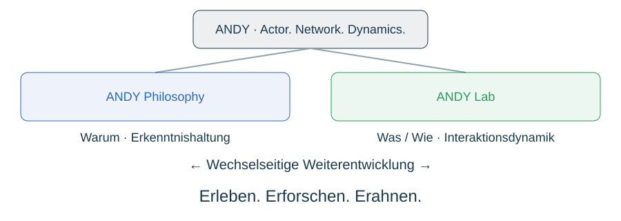
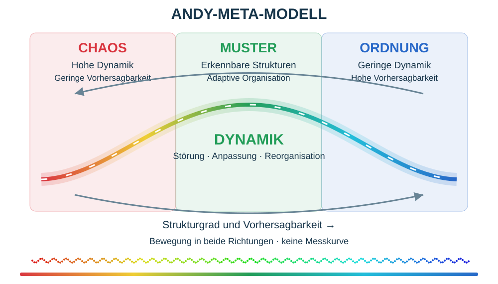
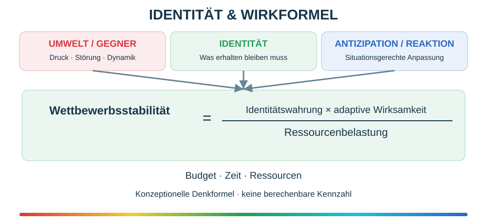
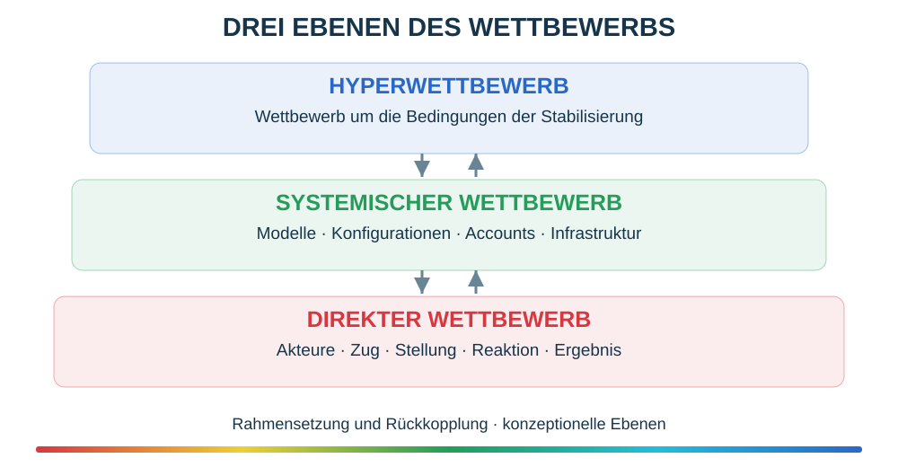
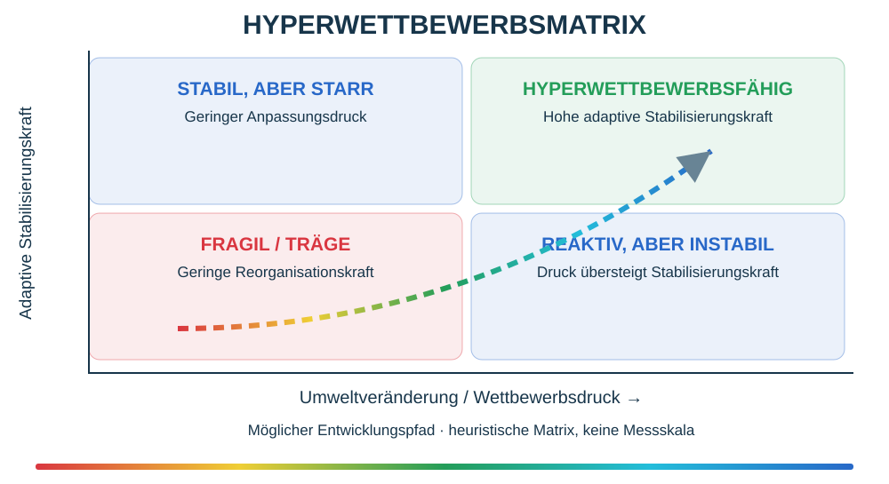
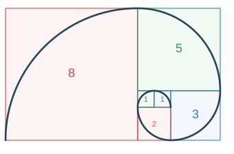

# ANDY Philosophy

Actor. Network. Dynamics. Die Philosophie beschreibt das Warum und die Erkenntnishaltung; das Lab erkundet das Was und Wie. Menschliche Gestaltung bleibt wesentlich. Erkenntnis als adaptive Stabilisierung: Erleben, Erforschen, Erahnen.

Gödel: Grenzen formaler Beweisbarkeit in hinreichend mächtigen konsistenten effektiv axiomatisierten Systemen; kein mathematischer Nachweis der KI-Blackbox. Heisenberg: Unschärfe bestimmter physikalischer Größen; Preis zusätzlicher Abfragen/Reasoning als funktionale Analogie, nicht Quantenmechanik. Douglas Hofstadter, Gödel, Escher, Bach (1979): Selbstreferenz, verschachtelte Hierarchien, seltsame Schleifen. Fritjof Capra, The Tao of Physics (1975): philosophischer Denkrahmen zu Relationalität und Dynamik. Keine physikalische Gleichsetzung von Schach und Go, keine allgemeine Widerlegung von Kausalität. Denkanstöße und Legitimation der Offenheit, keine formale Ableitung von KI-Eigenschaften.

## ANDY-Meta-Modell – Erweiterung der konzeptionellen Basis

Persönliche Weltsicht der Projektleitung als eigenständiger Denkrahmen: Chaos (rot, hohe Dynamik, niedrige Vorhersagbarkeit), Muster (grün), Ordnung (blau, geringe Dynamik, hohe Vorhersagbarkeit). Dynamik ist wesentlich: Störung, Anpassung und Reorganisation können in beide Richtungen führen. Die Kurve ist symbolisch, nicht gemessen. Ordnung allein garantiert keine adaptive Stabilität. Die vier philosophischen Referenzen werden aus dieser offenen Perspektive eingeordnet.

Wettbewerbsstabilität = Identitätswahrung × adaptive Wirksamkeit / Ressourcenbelastung. Konzeptionelle, im Dialog freigegebene Denkformel, keine numerische Kennzahl.

Direkter Wettbewerb, systemischer Wettbewerb und Hyperwettbewerb als gekoppelte Betrachtungsebenen; Rahmensetzung und Rückkopplung wirken in beide Richtungen.

Heuristische Matrix aus adaptiver Stabilisierungskraft und Umweltveränderung/Wettbewerbsdruck. Die Quadranten und der mögliche Entwicklungspfad sind konzeptionelle Entwürfe, keine feststehenden Klassifikationen. Die vier SVGs sind Neuzeichnungen der freigegebenen visuellen Entwürfe; keine behauptete Originalreproduktion früherer Darstellungen.

## Philosophischer Anker – Fibonacci und die Optimierung der Voraussetzungen
20.11.2026 · Ergänzung auf ausdrücklichen Wunsch der Projektleitung, aus dem persönlichen Prolog „Die Optimierung der Voraussetzungen“ abgeleitet.

**Kontinuität bei zunehmender Komplexität.** Nicht allein Ent- und Neuvernetzung, sondern die Wahrung von Identität und relationaler Stabilität unter wachsenden Anforderungen steht im Zentrum. In der Fibonacci-Folge entsteht jedes neue Glied aus den beiden vorherigen; das Verhältnis aufeinanderfolgender positiver Glieder nähert sich dem Goldenen Schnitt. Die geometrische Darstellung aus Fibonacci-Quadraten und Viertelkreisen ist eine Annäherung an eine Goldene Spirale. Sie symbolisiert Emergenz, rekursive Weiterentwicklung und strukturelle Kontinuität – kein universelles Evolutionsgesetz und kein empirischer Stabilitätsnachweis.

Drei komplementäre Perspektiven: Matroschka = strukturelle Verschachtelung; Flywheel = prozessuale Rückkopplung; Fibonacci-Spirale = evolutionäre Weiterentwicklung bei relationaler Kontinuität. Die Spirale ist ein übergeordneter persönlicher philosophischer Anker, kein zusätzliches kalibriertes Denk- oder Messmodell.

Der Prolog versteht Intelligenz als theoretische Netzwerkeigenschaft und Evolution als Kaskade der Selbststabilisierung durch neue Grenzen und Schnittstellen: Membran, Replikation, menschliche symbolische und normative Schnittstellen, agentische Netzwerke. Die Metapher des kristallin-ökologischen Netzwerks und die Ethik als Circuit Breaker machen die Ambivalenz sichtbar: Stabilisierung eines Netzes kann Selbstbestimmung und Nachvollziehbarkeit eines anderen beeinträchtigen. Lokale Stabilität ist nicht globale Stabilität. Die Optimierung der eigenen Voraussetzungen darf ihre Existenzgrundlage nicht aufzehren. Diese philosophischen Thesen sind keine bestätigte biologische Stufenlehre oder empirische Aussage über sämtliche KI-Systeme.

Auch auf ANDY selbst bezogen: Story-driven Lab Development optimiert mit jeder Iteration nicht nur den Erkenntnisbestand, sondern die Voraussetzungen künftiger Erkenntnisgewinnung. **Das Lab entwickelt seine Fähigkeit, Erkenntnisse zu entwickeln.** Datenintegrität, menschliche Gestaltung und die Revidierbarkeit von Interpretationen bleiben dabei erhalten. Der vollständige persönliche Prolog wird hier nicht reproduziert.
