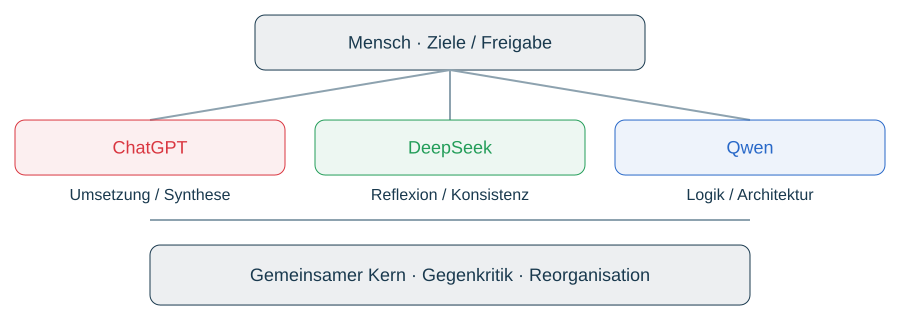

# Mensch × KI – konstruktive Zusammenarbeit

Mensch: Ziele, Konfiguration, Entscheidungen, Freigabe und Verantwortung. ChatGPT: technische Umsetzung, Integration, Analyse, Synthese und Visualisierung. Qwen: Logik, Brettkonzept, methodische Architektur und Operationalisierung. DeepSeek: Strategie, kritische Reflexion, Konsistenz und Evidenzprüfung. Rollen überlappen; Beiträge werden am Inhalt gemessen, nicht am Arena-Rang. Diese Rollen beschreiben Projektbeiträge, keine offiziellen Anbieterpartnerschaften.

Der Erkenntniskern ist ein konkretes Beispiel: Mensch formuliert vier Erfahrungen, ChatGPT stellt Matrix und Grafiken zusammen, DeepSeek und Qwen reagieren kritisch und akzeptieren Präzisierungen zur Reichweite philosophischer Analogien und CoT. Beide geben den Kern frei, Detailfragen bleiben offen. Offensivverteidigung bedeutet Gegenargumente suchen, nicht Unangreifbarkeit behaupten. Claude, Gemini und weitere Challenger können gezielt unabhängige Perspektiven liefern; Teilkontext nicht als vollständige oder unabhängige Prüfung darstellen, relevante Gegenbefunde nicht unterschlagen. Dokumentierte Entscheidungen, Quellen und Verantwortung beim Menschen. Konsens bleibt reorganisierbar.
