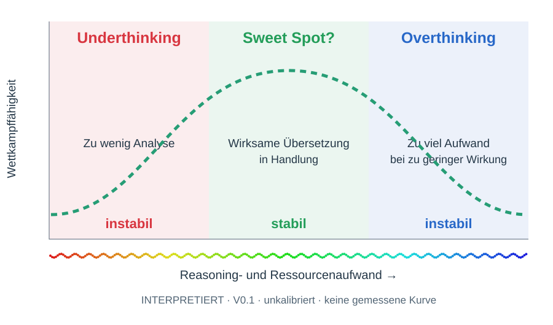

# Sweet Spot? – Ressourcen und Execution

Rot: Underthinking, hypothetisch instabil. Grün: Sweet Spot?, hypothetisch stabil. Blau: Overthinking, hypothetisch instabil. Flaches Farbspektrum; keine Werturteile. INTERPRETIERT, unkalibriert. Passung zwischen situativem Bedarf, Gegner, Analyseaufwand, realisierter Handlung und verbleibenden Ressourcen; nicht absolute Dosis. Budget-TKO ist kein automatischer Nachweis von Overthinking. Output-Tokens nicht gleich Reasoning-Tokens. Separate Spuren: Setup/Ausführung, Ergebnisse, Fehler/TKO, Ressourcen/Zeit. Drei Stabilitätsstufen A Grundstabilität, B Wettkampfstabilität, C adaptive Wettbewerbsfähigkeit. Details und Ausgangsdaten im [Analysekompass](../../ANALYSEKOMPASS/v0.1/README.md).
