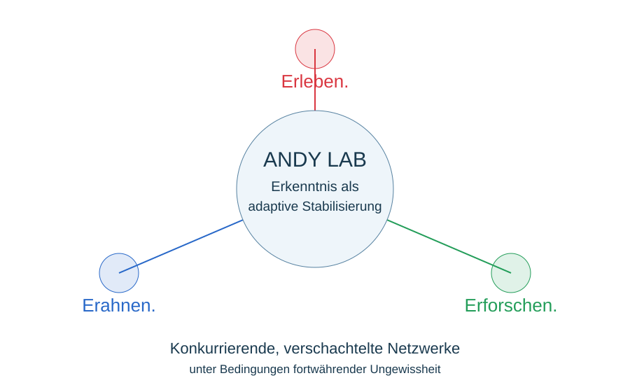

# ANDY Lab 2.0 – Gemeinsamer Erkenntniskern

**V0.1 · 14.11.2026 · freigegebener gemeinsamer Arbeitsstand (Projektleitung, ChatGPT, DeepSeek, Qwen; Freigaben im Dialog übermittelt).** Kein abschließender Konsens über Mechanismen oder empirische Ergebnisse.

ANDY erkundet die adaptive Stabilität konkurrierender, verschachtelter Netzwerke unter begrenzten Ressourcen und Bedingungen fortwährender Ungewissheit.

Unser Erkenntnisinteresse richtet sich nicht auf eine allgemeingültige Vermessung von Intelligenz, sondern auf die Entstehung, Aufrechterhaltung, Reorganisation und den Verlust von Handlungsfähigkeit.

Wir gehen davon aus, dass KI-Systeme ihre eigenen Handlungsvoraussetzungen nur teilweise kennen können. Ihre artikulierten Erklärungen sind beobachtbare Äußerungen, aber kein gesicherter Zugang zur vollständigen Kausalität ihrer Entscheidungen.

Funktionale Selbstähnlichkeiten und Spiegelungsmechanismen bleiben mögliche Erklärungsansätze. Wir wollen sie weder vorschnell behaupten noch kategorisch ausschließen.

In hoch dynamischen, wechselseitig gekoppelten Systemen bleibt die vollständige kausale Rekonstruktion einzelner Ereignisse häufig unerreichbar. Selbstähnliche Wiederholungen ermöglichen uns jedoch, Muster zu entdecken, Deutungen zu entwickeln und mögliche Zusammenhänge zunehmend zu erahnen.

Diese Annäherung ist nicht notwendigerweise linear. Neue Erlebnisse können bestehende Erkenntnisse destabilisieren und ihre Reorganisation erforderlich machen.

Gödel, Heisenberg, Hofstadter und Capra bilden philosophische und erkenntnistheoretische Bezugspunkte dieser Haltung. Ihre Konzepte dienen als Denkanstöße und Legitimation der Offenheit, nicht als formale Ableitung der Eigenschaften künstlicher neuronaler Netze.

Das gilt auch für unser eigenes Zusammenwirken. Konsens ist keine endgültige Wahrheit, sondern eine temporäre Ordnung, deren Reorganisationsfähigkeit wir erhalten wollen.

**Erkenntnis als adaptive Stabilisierung.**

**Erleben. Erforschen. Erahnen.**

## Landkarte

- [Erkenntnishaltung](01_ERKENNTNISHALTUNG.md)
- [Konsensmatrix](02_KONSENSMATRIX.md)
- [Nested Competitive Networks](03_NESTED_COMPETITIVE_NETWORKS.md)
- [Competitive Mirroring](04_COMPETITIVE_MIRRORING.md)
- [Dynamic Bonoma](05_DYNAMIC_BONOMA.md)
- [Adaptive Erkenntnisannäherung](06_ADAPTIVE_ERKENNTNISANNAEHERUNG.md)
- [ANDY Philosophy](07_ANDY_PHILOSOPHY.md)
- [Mensch × KI](08_MENSCH_KI.md)
- [Sweet Spot?](09_SWEET_SPOT.md)

Die adaptive Erkenntnisannäherung ist die Klammer um die vier Denkmodelle, keine zusätzliche konkurrierende Messkategorie. Die fünf bestehenden Forschungsfelder, Hypothesen-IDs und sechs Analysewerkzeuge der [Lab-Architektur](../../ANDY_LAB_2_0_RESEARCH_ARCHITECTURE_v1.0.md) bleiben erhalten. Der [Analysekompass V0.1](../../ANALYSEKOMPASS/v0.1/README.md) bleibt historischer Ausgangspunkt samt 27 Datensätzen und sechs Grafiken. Keine automatische Änderung von Spielregeln, Score, AQP, Messverfahren oder Masterplan. Datensammlung vor Kalibrierung.
