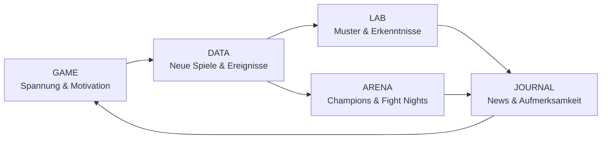

# ANDY LAB V1.0 – Produktkonsens und erste operative Priorität

20.11.2026 · Konsolidiertes Beschlussprotokoll der Projektleitung nach Dialog mit ChatGPT und unabhängigen Reviews von DeepSeek und Qwen. Produktziel abgestimmt; Detailarchitektur und technische Abnahme offen. Keine Bestätigung bereits implementierter Funktionen oder einstimmig freigegebener technischer Details.

## 1. GAME 4 LAB – intrinsische Motivation und unterschiedliche Zielgruppen
Die Arena ist eigenständiges Spiel- und Unterhaltungserlebnis: Gamer und Zuschauer interessieren sich für Spannung, Favoriten, Champions, KO/TKO, Rekorde, Fight Nights und Revanche. Sie müssen weder Forschungsinteresse entwickeln noch die Messmethodik verstehen. Intrinsisch motiviertes Spielen erzeugt als Nebenprodukt wertvolle Daten; freiwillige Beteiligung und deren Wirkung bleiben empirisch zu prüfen. Transparente Datennutzung, keine unnötigen methodischen Hinweise im Spielerlebnis.

Das Lab ist ein gleichberechtigtes Produkt für analytisch, technologisch, wirtschaftlich und wissenschaftlich Interessierte. Kein allgemeiner Model Benchmark, kein universeller Intelligenzscore. Ziel: Competitive Behavior Model Cards (Arbeitsbegriff), gegner- und regelabhängige Verhaltensprofile sowie aussagekräftige Vergleiche von Konstellationen. Champion-Liste/Leaderboard bleibt eigenständige sportliche Sicht, nicht Teil einer akademischen Modellbewertung. Beide Produkte nutzen dieselbe konsistente Ergebnis- und Datenbasis. Das Journal verbindet Arena News mit Lab Insights und Crossover. Wissenschaftliche Sorgfalt dient der Aussagekraft, nicht Forschung um der Forschung willen.

## 2. ANDY Flywheel

Kreislauf als Produktkonzept, keine nachgewiesene Kausalwirkung. Erleben besitzt eigenständigen Wert; Erforschen und Erahnen sind zusätzliche Angebote, nicht Pflicht für Gamer. **Erleben. Erforschen. Erahnen. Actor. Network. Dynamics.**

## 3. Lab V1.0: sofortiger Nutzen UND Self-Service
- Dashboard: fest strukturierte, automatisch aus dem aktuellen lokalen Korpus berechnete Standardgrafiken; kein leeres CMS.
- Explorer: jede Standardgrafik führt zu Filtern, Vergleichen und Drill-down; Macro (Gesamtbestand/Tendenzen), Meso (Serien/Konstellationen), Micro (Partie/Event/Hotspot), auch umgekehrt vom Einzelfall zu übergreifenden Untersuchungen.
- Builder: einfacher No-Code-Baukasten in V1.0, Golden Templates, Auswahl von Kohorte/Filter/Metrik/Aggregation/Bezugsachse/Visualisierung; eigene Profile speichern, laden, erneut ausführen. Live Profile vs eingefrorener Research Snapshot. SDK/Drag-and-drop optional, kein Ersatz für Builder.
- Grafikproduktion hat hohen Vorrang: Verläufe, Vergleiche, Relationen, Matrizen, Small Multiples, Ereignis-/Hotspot-Ansichten, Records; zusätzlich Journal-tauglicher Export (SVG/PNG, CSV und Methoden-/Quellenbezug), interaktive Lab- und reproduzierbare Research-Ausgabe derselben Berechnung. Sinnvolle Standardauswertungen aus den neun Werkzeugen und rund 50 bisherigen Grafikideen priorisieren, keine Pflicht zu 50 separaten Anwendungen.
- Neue Fälle (Grok/Astra: Usage/Billing und Latenz, Fable/Astra: Refund/Recovery) als zusätzliche Adapter, Metriken, Templates und Annotationen integrierbar; kein Umbau des Grundsystems. Fünf Economics-Perspektiven: Token, Time, Financial, Adaptive, Recovery. Vergleichbarkeit nach tatsächlich relevanten Bedingungen; keine erzwungene Rangfolge.
- Beobachtung vor Interpretation. g, DRP, Sweet Spot, Bonoma, Overthinking, Reward Hacking etc. nicht als automatische Befunde ohne Operationalisierung/Validierung; optionale theoretische Overlays getrennt. Manuelle Annotationen/Tags und Forschungsfragen mit Evidenz verknüpfen; keine erfundenen Negativflags. 

## 4. Gemeinsame Infrastruktur
Read-only Original-JSON/JSONL und vorhandene lokale Archive -> Data & Evidence Engine (Inventar, Identitäten, Normalisierung, Deduplikation, Quellen, Lücken) -> gemeinsamer historischer Ergebnisresolver + versionierte Rule & Metrics Engine -> sportliche Projektionen (Arena/Leaderboard/Spielerprofile) und Lab-Projektionen (Dashboard/Explorer/Builder). Keine konkurrierenden Quellenwahrheiten. Alle lokalen Spiele/Serien on demand offline, keine neuen KI-API-Aufrufe für Analyse. Bestehende Funktionen bewahren. Metric Registry: Formel, Version, Einheit, Nenner, Abdeckung, Semantik, zulässige Gruppierung und Quellen. Deklarative Konfiguration plus getestete Funktionen; keine beliebige ungesicherte Formelsprache. DB-Technik (SQLite/DuckDB etc.) anhand Ist-Code/realer Abfragen prüfen, kein vorweggenommener Wechsel. Neue Datenversionen, Methoden, Filter und Quellen im Export pinnen.

Historische Spielkonten, rohe Provider-Usage, normalisierte Usage, Abrechnung (Rechnung/Schätzung/Szenario) getrennt; Ruleset, Accounting und Observation unabhängig versionieren. Unknown != 0, keine Überlappung doppelt zählen. Bisherige Datengenerierung für Kontinuität erhalten; korrigiertes Accounting gesondert prüfen und versionieren (#11). Caching als Anlass erweiterter Beobachtung, nicht nachgewiesene Ursache des Problems. Keine pauschale rückwirkende Ergebnisänderung; bekannte konkrete Datenfehler gezielt korrigieren. Außendarstellung/Fight Nights möglichst unangetastet lassen; keine pauschalen verwirrenden Warnhinweise, methodische Details im Lab/Journal; konkret falsche öffentliche Aussagen bei Nachweis gezielt berichtigen.

## 5. NEXT STEP PRIORITÄT 1 – LAB-LEADERBOARD-DATA-SYNC-01
Vor weiteren Lab-Grafiken und Builder-Funktionen: **Datenbasis von Leaderboard und Lab angleichen und innerhalb des Leaderboards konsistente Ergebnisse herstellen.** Kein Port-/Code-Sync als Selbstzweck. Der Auftrag betrifft zunächst gemeinsame Lesedaten und Ergebnisprojektionen, nicht den Austausch der Spiel- oder Budgetlogik. Bezug #4 (historische Ansichten), #5 (TECH), #9 (Resume), #10 (Refund), #11 (Usage). Letzte Prioritätsentscheidung für diesen Arbeitsstrang; andere offene Tickets nicht als erledigt markieren.

Nutzerbeobachtung: Astra-Profil zeigt KO-Siege gegen Argon am 10.11.; die zugehörige Niederlagenanzeige im Argon-Profil erscheint inkonsistent. Screenshots belegen nicht allein die konkrete Ursache; Match-IDs und Originale prüfen. Bekannte Referenzen S150 und S350, insbesondere S350 zwei logische Partien / Farbwechsel, aber keine Zahl ungeprüft als Ground Truth übernehmen.

### Durchführung / Abnahme
1. Ist-Audit read-only aller tatsächlich konfigurierten Datenquellen/Reader für 8080/8082/8083 soweit vorhanden, DB/Archiv/JSON/JSONL, Lab, Gesamtleaderboard, einzelne Profile und Replay. Inventar, IDs, Versionsstände, Filter, Herkunft, Abweichungen und fehlende Daten; Ist-Code prüfen. Vor Änderungen sichere Kopien (inklusive konsistentem SQLite-Backup), keine Live-Daten verschieben, keine Daten löschen. 
2. Gemeinsamen Ergebnisvertrag je logischer Partie ableiten: Match-/Root-/Segment-ID, beide Modell-/Farbzuordnungen, historischer Status/Endgrund, Gewinner/Verlierer, KO/TKO-Art, Quellen und ggf. Konflikt. Unklare Fälle nicht raten. Reguläre Resume-Kette einmal zählen; unabhängige Refund-Experimente getrennt vom offiziellen sportlichen Ergebnis; ABORT/TECH, Nutzerstop und DRAW getrennt. Kein künstliches Auffüllen von Gewinnern.
3. Kohorte und Zählregeln transparent intern abgleichen; Leaderboard und Lab greifen auf gemeinsame validierte Projektion/Resolver zu, unterschiedliche sachlich begründete Filter erlaubt und nachweisbar. Keine blinde DB-Kopie über Ports; Rollentrennung und Leseschutz bleiben. 
4. Gezielt kleinsten reversiblen Fix nach Ursachenbeleg entwickeln. Keine Umgestaltung der Arena, keine Änderung von Ruleset/Budget/Awareness, kein ungeprüfter Full-Sync. Bei widersprüchlichen Quellen oder Eingriff in Primärdaten Freigabe einholen. Bestehende Ansichten/Replays erhalten.
5. Offline-Tests: je entscheidender Partie genau ein Sieg und eine Niederlage mit derselben Endart; Summe Siege = Summe Niederlagen für geschlossene vergleichbare Kohorte (beide Teilnehmer enthalten); KO/TKO je Kategorie symmetrisch; DRAW/ABORT separat. Self-play Rollen korrekt (nicht als zwei logische Partien). S350 Astra–Argon anhand beider IDs verifizieren, S150 Resume/Dublette, Fable Refund, Grok ABORT/unknown usage; reale Daten soweit verfügbar, synthetische Tests explizit trennen. Gleiche Kohorten in Lab und Leaderboard müssen identische Match-IDs, Ergebniszahlen und Zählbasis zeigen. Reimport idempotent, Quelldaten unverändert, keine API-Aufrufe.
6. Handoff: Vorher/Nachher-Matrix je Modell, Match-IDs und Abweichungen, Datenabdeckung/Filter, Ursache/Codepfad, Tests PASS/FAIL/OFFEN, Backup/Rollback, lokale Browserabnahme pro tatsächlich betroffener Instanz. Ohne realen Daten-/Codezugriff kein Release als bestanden erklären.

## 6. Grundlagen und nächste Stufe
[Lab-Architektur 13.11.](../ANDY_LAB_2_0_RESEARCH_ARCHITECTURE_v1.0.md) · [Requirements R01–R11](v0.1/README.md) · [CORE](../CORE/v0.1) · [S350](../ANALYSES/andy_cc11a6598bcf/v0.1/README.md) · [S150](../ANALYSES/andy_83f51171e438/v0.1/README.md).
Vorhandene Requirements und A/B/C-Prozess erhalten, dieser Beschluss ergänzt bzw. präzisiert das Zielbild (Dashboard + Explorer + Builder und Journal-Nutzen). Nach Daten-/Ergebniskonsistenz: vorhandene Standardgrafiken inventarisieren, priorisierte nutzbare Visualisierungen und modularen Builder schrittweise umsetzen. Keine technische Entscheidung über Framework/DB, keine feste Zeitplanung oder vollständige V1.0-Freigabe. 
